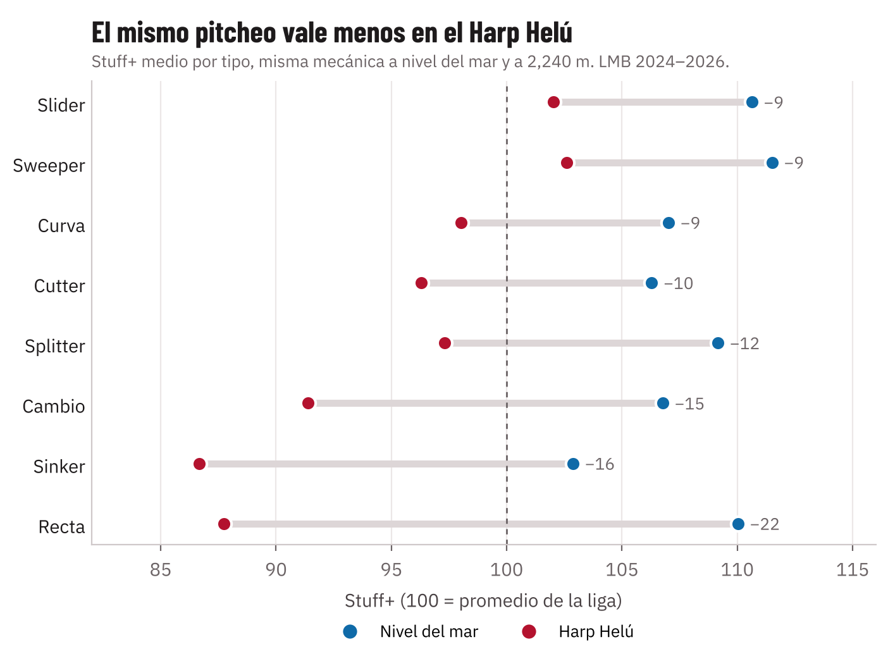
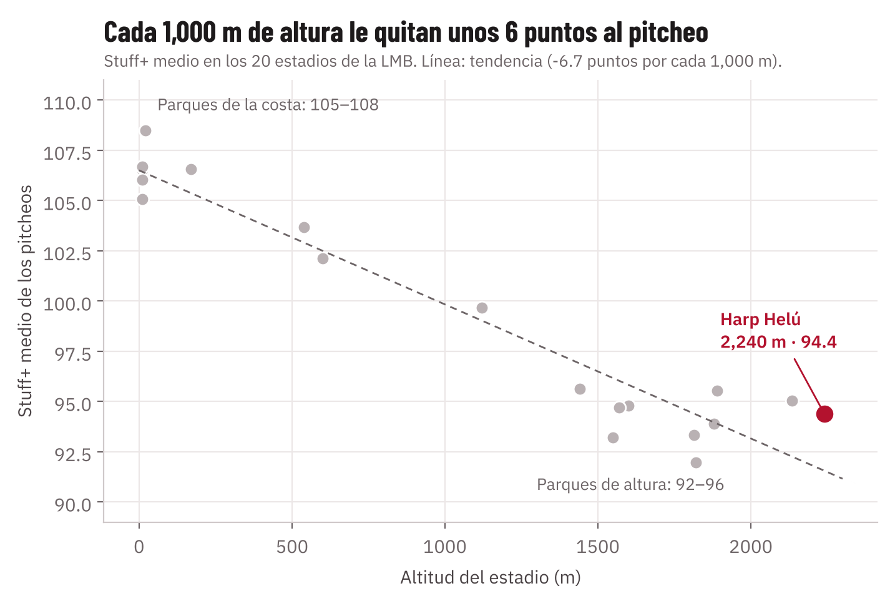
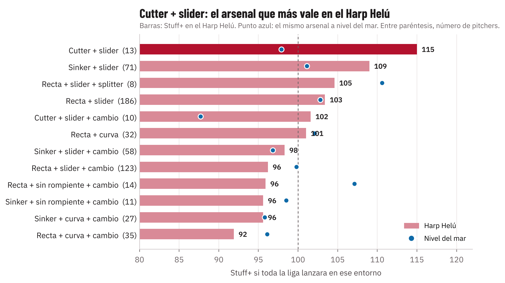
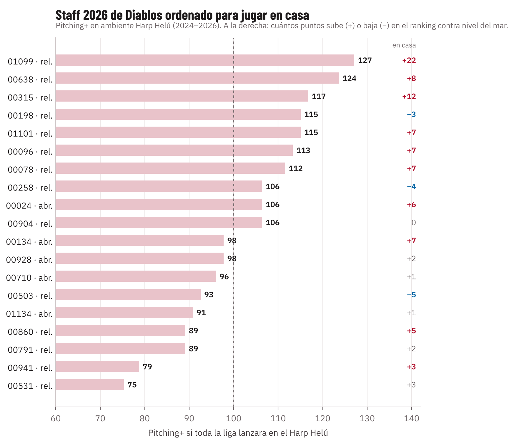

---
numero: 1
titulo: Stuff+ por pitcheo, pitcher y arsenal
pregunta: ¿Qué tan bueno es cada pitcheo, cada pitcher y cada arsenal en el Harp Helú, y cuánto le quita la altura?
---

> **En 30 segundos**
>
> - Calificamos cada uno de los **629,616 pitcheos** de la LMB 2024–2026 con tres números: **Stuff+** (el brazo), **Location+** (la ubicación) y **Pitching+** (todo junto). 100 es el promedio de la liga.
> - **La altura le quita al pitcheo lo que el giro le da.** El mismo pitcheo vale en promedio **6 a 7 puntos menos por cada 1,000 m**. En el Harp Helú la recta pierde **22 puntos** y el slider solo **9**.
> - **El arsenal que más vale en casa es cutter + slider** (Stuff+ 115 en el Harp Helú contra 98 a nivel del mar). El que más sufre es recta + cambio sin rompiente.
> - **En el staff 2026**, los relevistas 01099, 00638 y 00315 son los que mejor rinden en ambiente Harp Helú.

## Cómo leer los tres números

Los tres scores responden la misma pregunta: si este pitcheo se lanzara mil veces, ¿cuántas carreras le quitaría al rival comparado con un pitcheo promedio de la liga? No importa si ese lanzamiento en particular terminó en hit o en out; importa qué tan difícil es de batear.

| Score | Qué mira | En palabras de dugout | Para qué sirve |
|---|---|---|---|
| **Stuff+** | Solo la física al soltar la pelota: velocidad, giro, movimiento, release, extensión y cómo se separa de la recta del mismo pitcher | "¿Qué tan buena es la bola?" Lo que ve el scout con la pistola y el TrackMan | Evaluar el brazo y el arsenal |
| **Location+** | Solo dónde cruzó el plato, en qué cuenta y contra qué mano | "¿La puso donde debía?" El comando | Evaluar la ejecución |
| **Pitching+** | Todo junto, más el cansancio (número de pitcheo y de bateadores enfrentados) | "¿Qué tan bueno fue el pitcheo completo?" | Evaluar el resultado esperado de cada lanzamiento |

**La escala se lee como ERA+ u OPS+:** 100 es el promedio de la LMB y más alto siempre es mejor para el pitcher, sin importar si es una recta o una curva. Cada 10 puntos separan a un pitcheo promedio de uno claramente mejor: un 110 está arriba del 84 % de la liga y un 120 está entre el 3 % mejor. En carreras, 10 puntos de Stuff+ equivalen a unas 1.3 carreras menos por cada 100 pitcheos, más o menos lo que lanza un abridor en una salida larga.

**Truco para el scout:** Stuff+ menos 50 da el grado en la escala 20–80. Un Stuff+ de 110 es un pitcheo de 60; uno de 120, un 70.

| Stuff+ | Lectura | Grado de scout (20–80) | Cuántos pitcheos de la liga llegan ahí |
|---|---|---|---|
| 120 o más | Élite | 70 o más | Más o menos 3 de cada 100 |
| 110 a 119 | Arriba del promedio | 60 | 1 de cada 7 |
| 91 a 109 | Promedio | 45–55 | 2 de cada 3 |
| 81 a 90 | Abajo del promedio | 40 | 1 de cada 7 |
| 80 o menos | Nivel de reemplazo | 30 | Más o menos 3 de cada 100 |

Esta es la escala que pide el reto. El mismo 100 + 10 puntos aplica a Location+ y Pitching+, y al ranking de pitchers en *ambiente Harp Helú*: ahí 120 quiere decir "de los mejores de la liga si todos lanzaran en el Harp Helú".

## Score de cada lanzamiento

Cada pitcheo trae su Stuff+, Location+ y Pitching+ en el ambiente donde se lanzó, y además su Stuff+ si se hubiera lanzado a nivel del mar y en el Harp Helú con la misma mecánica. Así se ve, por ejemplo, el relevista **00315** de Diablos en el Harp Helú en 2026:

| Pitcheo | Velocidad | Cuenta | Resultado | Stuff+ | Location+ | Pitching+ | Stuff+ si fuera a nivel del mar |
|---|---|---|---|---|---|---|---|
| Slider | 84.9 mph | 0-1 | Swing y fallo | 111 | 97 | 102 | 115 |
| Slider | 86.1 mph | 1-2 | En juego | 109 | 102 | 108 | 117 |
| Sinker | 93.5 mph | 0-0 | Strike cantado | 90 | 102 | 103 | 97 |
| Recta | 93.7 mph | 0-0 | Swing y fallo | 94 | 107 | 108 | 113 |

**Qué se lee aquí:** su slider es arriba del promedio aun en casa. Su recta sería un pitcheo de 60 en la costa (113), pero en el Harp Helú baja a promedio (94): la altura le quita casi 20 puntos. Lo que salva a esa recta es la ubicación (Location+ 107).

> **Un aviso para el cuerpo técnico.** Un solo pitcheo dice poco, igual que un solo turno al bat no dice si un bateador es bueno: un batazo de 70 mph puede caer de hit y una línea de 105 puede ser out. El valor del Stuff+ aparece al juntar cientos de pitcheos de un pitcher o de un tipo de pitcheo. Por eso las decisiones de este reporte se toman con promedios, no con lanzamientos sueltos.

## Cuánto le quita la altura a cada tipo de pitcheo

Tomamos cada pitcheo de la liga y lo evaluamos dos veces con la misma mecánica: a nivel del mar y a 2,240 m. Todos pierden, pero no lo mismo.

- **Los que más pierden son recta (−22), sinker (−16) y cambio (−15).** Viven del movimiento que da el giro: el bote de la recta y la corrida del sinker y del cambio. En el aire delgado ese movimiento se reduce.
- **Los que menos pierden son slider, sweeper y curva (−9) y cutter (−10).** Engañan sobre todo por la diferencia de velocidad con la recta y por el ángulo con que llegan, y eso la altura no lo cambia.

## El Harp Helú contra los otros estadios de la LMB

| Estadio | Altitud | Stuff+ medio | Carreras por 100 pitcheos (real) |
|---|---|---|---|
| **Harp Helú (Diablos)** | **2,240 m** | **94.4** | **+0.87** |
| Hermanos Serdán (Puebla) | 2,135 m | 95.1 | +0.55 |
| Francisco Villa (Durango) | 1,890 m | 95.6 | +0.52 |
| Alberto Romo Chávez (Aguascalientes) | 1,880 m | 93.9 | +1.02 |
| Revolución (Torreón) | 1,120 m | 99.7 | −0.03 |
| Monclova | 600 m | 102.1 | −0.36 |
| Chevron (Tijuana) | 20 m | 108.5 | −1.12 |
| Promedio de los 7 parques de costa | ≤ 170 m | 106.5 | −0.93 |

**Cómo se cuantifica el efecto altitud.** Entre el parque más bajo y el Harp Helú hay **14 puntos de Stuff+ de diferencia**, y la tendencia es de **6.7 puntos por cada 1,000 m**. En carreras, el pitcheo en el Harp Helú permite casi **2 carreras más por cada 100 pitcheos** que en la costa. Dicho en el dugout: el mismo abridor, con la misma salida de 100 pitcheos, sale con casi dos carreras más en la pizarra en casa que en Tijuana. El reporte 4 muestra que el modelo anticipa bien este efecto con pitchers reales.

> **Ojo con los nombres de los estadios.** Los datos de ISAC solo dicen si un juego fue en altura baja, media o extrema. Los equipos y sus estadios los identificamos por el récord y por qué pitchers lanzan juntos; ISAC no los ha confirmado. La altitud de cada parque es la del estadio que identificamos.

> **Qué significa para Diablos.** El efecto no es exclusivo de la Ciudad de México: todos los parques de altura bajan el pitcheo. La diferencia es que Diablos juega ahí la mitad de su temporada, así que para su staff no es un ajuste de una serie sino la condición normal de trabajo.

## Qué arsenal produce el Stuff+ más alto en el Harp Helú

Agrupamos a los 601 pitchers con al menos 300 pitcheos según su recta principal, su rompiente principal y si usan un cambio de velocidad. Luego calificamos a toda la liga como si todos lanzaran en el Harp Helú.

| Arsenal | Pitchers | Harp Helú | Nivel del mar | Qué pasa |
|---|---|---|---|---|
| **Cutter + slider** | 13 | **115** | 98 | Mediocre en la costa, el mejor en casa |
| Sinker + slider | 71 | 109 | 101 | Sube 8 puntos en el ranking |
| Cutter + slider + cambio | 10 | 102 | 88 | Sube 14 puntos en el ranking |
| Recta + slider | 186 | 103 | 103 | Se mantiene |
| Recta + cambio, sin rompiente | 14 | 96 | **107** | Bueno en la costa, de los peores en casa |
| Recta + curva + cambio | 35 | 92 | 96 | El más bajo en casa |

**La respuesta:** el arsenal que más Stuff+ produce en el Harp Helú es **cutter + slider**, porque ninguno de los dos pitcheos depende del movimiento por giro. La proporción de rompientes lo confirma: los pitchers con más de 50 % de sliders y curvas ganan 13 puntos en el ranking del Harp Helú, y los que lanzan menos de 20 % pierden 6. El cutter + slider se apoya en solo 13 pitchers, así que su 115 es una señal fuerte, pero no una cifra exacta.

## Por pitcher: el staff 2026 de Diablos en casa

La gráfica ordena a los pitchers que lanzaron para Diablos en 2026 por su Pitching+ si toda la liga lanzara en el Harp Helú. Es como ajustar la efectividad por parque: compara a todos en la misma cancha. El número de la derecha dice cuántos puntos sube o baja en el ranking contra nivel del mar.

- **Los mejores en casa son tres relevistas:** 01099 (127, sube 22), 00638 (124) y 00315 (117, sube 12). Los tres tienen una recta, sinker o cutter de poco bote, y un slider o curva de mucho giro.
- **Los que más bajan en casa** son 00503 (−5), 00258 (−4) y 00198 (−3). Viven de rectas y sinkers con mucho bote y corrida.
- **Ningún abridor 2026 está arriba de 106.** La rotación de casa es el punto débil del staff actual, y es donde más rinde fichar el perfil del reporte 2.

> **Una nota sobre el staff.** Los datos van de 2024 a 2026, y varios pitchers que fueron Diablos ya no están. 00619 y 01060 solo lanzaron para Diablos en 2024. 00778 se fue a Tigres en 2025 y 00069 a Saraperos en 2026. Por eso este reporte solo usa el staff 2026 para las decisiones, y a los demás los cita como ejemplos del perfil que conviene buscar.
