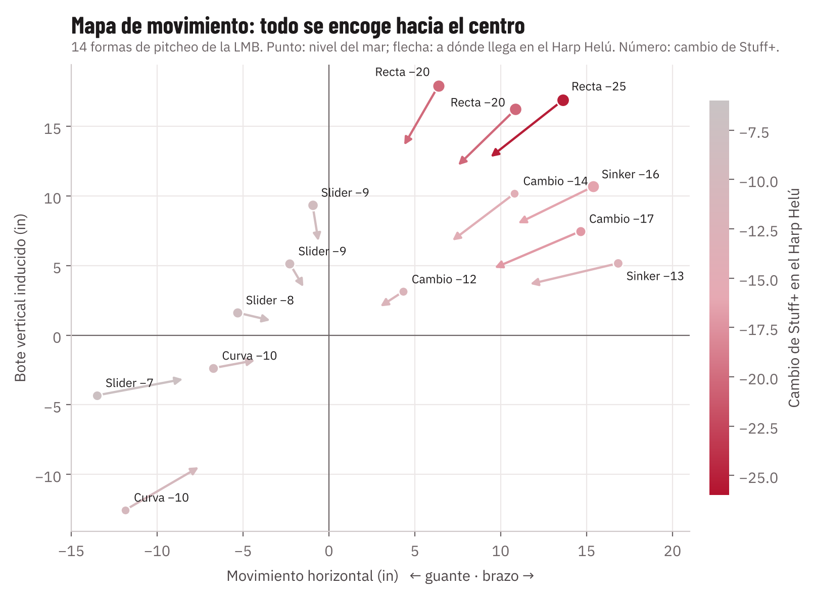
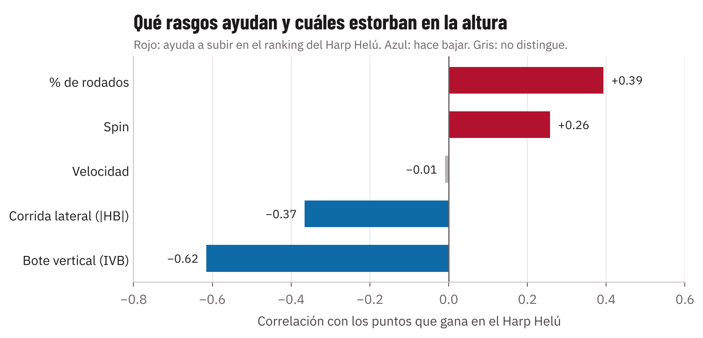
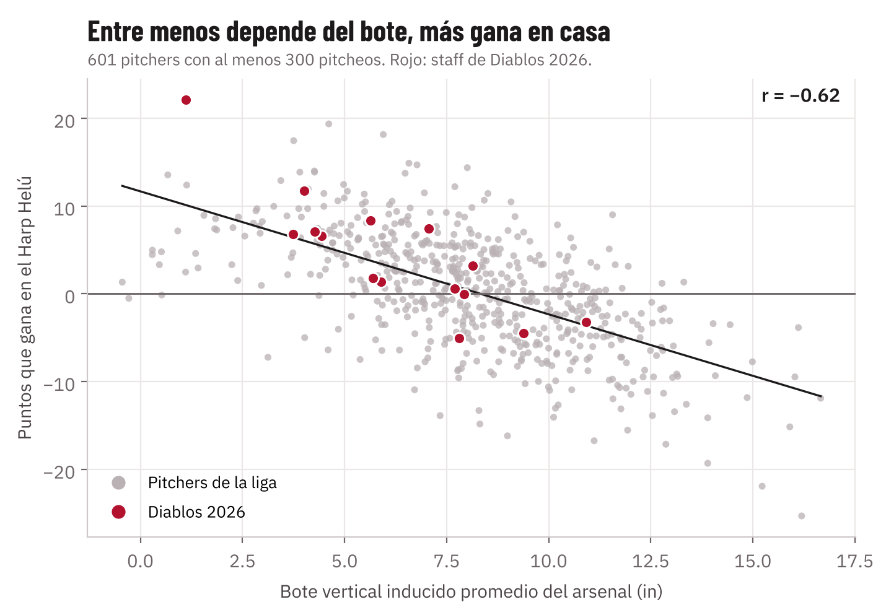

---
numero: 2
titulo: Perfil físico ideal para Diablos Rojos
pregunta: ¿Qué características físicas y qué arsenal maximizan el Stuff+ en el Harp Helú, y por qué importan más en altura?
---

> **En 30 segundos**
>
> - **El pitcher ideal para el Harp Helú es el que no necesita el aire para ser bueno:** una recta o cutter de poco bote, un slider o curva de mucho giro, muchos rompientes y batazos al suelo.
> - **El rasgo que más pesa es el bote vertical**, el "ride" que hace que la recta parezca subir. Entre menos depende el arsenal del bote, más sube el pitcher en casa; es la relación más fuerte que encontramos. Los pitchers con bote promedio menor a 6 pulgadas ganan entre 5 y 7 puntos en el ranking del Harp Helú; los de más de 12 pierden 8.
> - **Es casi el opuesto de lo que se busca en Grandes Ligas.** Allá se paga la recta de mucho bote arriba de la zona, y aquí esa es la que más pierde. Por eso Diablos puede encontrar valor en pitchers que el mercado subestima.
> - **En la liga hay candidatos que ya cumplen el perfil**, sobre todo para la rotación, que es lo que más le falta al staff 2026.

## Por qué la altura cambia lo que importa

A 2,240 m el aire es cerca de 20 % menos denso que a nivel del mar. Es lo mismo que pasa en Coors Field, en Denver, pero 600 m más arriba. Eso tiene tres efectos sobre el pitcheo, y los tres apuntan al mismo perfil.

| Qué cambia | Qué le pasa a la pelota | Qué medimos en la LMB |
|---|---|---|
| **Menos fuerza Magnus** (el empuje que da el giro: lo que hace que la recta "suba" y que el sinker corra) | El pitcheo se mueve menos. El bote de la recta y la corrida del sinker y del cambio se encogen | El mismo pitcher pierde 4.8 in de bote y 3.4 in de corrida en la recta, y 5 in de corrida en el cambio |
| **Menos arrastre** | La pelota frena menos en su camino al plato y la bateada viaja más lejos | La recta frena 1.5 mph menos. Un elevado viaja de 10 a 35 pies más |
| **La gravedad no cambia** | La caída que viene de la gravedad, y no del giro, se mantiene | Slider y curva conservan su separación de velocidad y su ángulo de llegada |

La consecuencia es directa: **en altura todos los pitcheos se parecen más a una pelota sin giro.** El que dependía de moverse pierde más, y el que engaña por velocidad, separación y ángulo pierde menos.

En el mapa cada punto es una forma de pitcheo de la LMB a nivel del mar, y la flecha marca a dónde llega en el Harp Helú. Las rectas, arriba a la derecha, recorren el camino más largo hacia el centro y pierden de 20 a 25 puntos. Los sliders casi no se mueven y pierden de 7 a 9.

## Qué rasgos ayudan y cuáles estorban

Para cada uno de los 601 pitchers con al menos 300 pitcheos calculamos cuánto sube o baja en el ranking de la liga si todos lanzaran en el Harp Helú. Después medimos qué rasgos acompañan a los que suben.

| Bote vertical promedio del arsenal | Pitchers | Puntos que gana en el Harp Helú |
|---|---|---|
| Menos de 3 in | 30 | **+6.5** |
| 3 a 6 in | 102 | +5.4 |
| 6 a 9 in | 252 | +1.4 |
| 9 a 12 in | 171 | −2.8 |
| Más de 12 in | 46 | **−8.3** |

| % de rodados en bolas en juego | Pitchers | Puntos que gana en el Harp Helú |
|---|---|---|
| Menos de 40 % | 238 | −2.0 |
| 45 a 50 % | 105 | +1.7 |
| 50 a 55 % | 53 | +5.0 |
| Más de 55 % | 44 | **+5.8** |

**Por qué importa cada rasgo en altura.** Entre paréntesis va la correlación: qué tanto acompaña ese rasgo a los pitchers que suben en casa. Va de −1 a +1. Cerca de 0 quiere decir que no tiene que ver; más allá de ±0.5 es una relación fuerte. Con signo negativo, entre más tiene el pitcher de ese rasgo, más pierde en casa.

- **Poco bote (correlación −0.62, la más fuerte).** El bote es Magnus puro: quien no lo tiene no lo pierde, y su recta se ve igual en casa que de visita. A nivel del mar la recta de 16 a 18 pulgadas de bote vale 118. En el Harp Helú vale 80, por debajo de la recta de menos de 12 pulgadas, que vale 86.
- **Poca corrida lateral (−0.37).** También es Magnus. La corrida grande del sinker y del cambio es lo primero que desaparece.
- **Muchos rodados (+0.39).** Con la misma velocidad de salida y el mismo ángulo, un elevado vale +0.087 carreras más en el Harp Helú y un rodado solo +0.046. Por cada 100 elevados son casi 9 carreras extra; por cada 100 rodados, menos de 5. El rodado pierde la mitad.
- **Mucho giro en cutter, slider y curva (+0.26).** En estos pitcheos el giro no sostiene la pelota, le da forma. La cuarta parte de los sliders con más giro (más de 2,580 rpm) valen 116 en el Harp Helú, contra 111 los de menos giro. En el cutter la diferencia es mayor: 112 contra 102.
- **Velocidad (−0.01).** No distingue quién sube o baja, porque vale lo mismo arriba y abajo. Pero sigue sumando: en la recta y la curva más velocidad es más Stuff+ en cualquier parque. Es un requisito, no un diferenciador.
- **Mano.** Los zurdos suben 1.8 puntos en promedio y los derechos se quedan igual. Es un efecto chico: desempata, no decide.

## Qué pesa más dentro del modelo

Para saber qué variables físicas mueven el Stuff+ usamos valores SHAP. La idea es la misma que repartir el crédito de un rally entre los bateadores que participaron: a cada pitcheo le repartimos su score entre sus ingredientes (velocidad, giro, movimiento…) y vemos cuántos puntos aporta cada uno.

| Variable | Puntos de Stuff+ que mueve en promedio | Lectura |
|---|---|---|
| Altitud del parque | 4.6 | La que más pesa: +5 en la costa, −5 arriba de 1,500 m |
| Separación de velocidad con la recta | 2.5 | Lo que más define a un cambio (4.1) y a un slider (2.8) |
| Desvío entre el eje de giro y el movimiento | 2.4 | El efecto de la costura. En rectas y cutters, más desvío es mejor |
| Velocidad | 1.4 | En la curva pesa 3 puntos |
| Movimiento total | 1.2 | Ayuda en recta y sinker, pero es justo lo que la altura quita |
| Giro por sí solo | 0.7 | Pesa poco: importa qué forma le da a la pelota, no cuánto gira |

**La lectura para el cuerpo técnico:** los rasgos que la altura no toca (separación de velocidad, efecto de la costura, velocidad) pesan más que el giro en sí. Ahí está el margen de un pitcher en casa. Un cambio con 8 a 12 mph de separación con su recta vale unos 10 puntos más que uno con menos de 6, y la altura les quita lo mismo a los dos. El primero llega al Harp Helú con colchón; el segundo queda muy por debajo del promedio.

## La ficha del pitcher ideal para Diablos

| Componente | Qué buscar | Por qué |
|---|---|---|
| **Recta** | Poco bote (menos de 12 in) o, mejor, un cutter de 88 a 91 mph | No pierde lo que no tiene. La recta de mucho bote es la que más sufre |
| **Rompiente principal** | Slider o curva de mucho giro, con buena separación de velocidad con su recta | Pierde 9 puntos, contra 22 de la recta |
| **Mezcla** | Más de 35 % de rompientes; ideal, cerca de 50 % | Con más de 50 % suben 13 puntos en el ranking; con menos de 20 % bajan 6 |
| **Batazo** | Más de 50 % de rodados en bolas en juego | El rodado no vuela; el elevado sí |
| **Cambio** | Si lo usa: firme, de poca corrida y siempre abajo | El cambio de poca corrida pierde 12; el de mucha corrida, 17 |
| **Velocidad** | La más alta posible | No la quita la altura y suma en cualquier parque |
| **Mano** | Zurdo, si todo lo demás empata | Ventaja chica, de 1 a 2 puntos |

**En una frase:** velocidad, un cutter o una recta plana, un slider de mucho giro y un batazo que va al suelo.

**El arsenal que más rinde con este perfil es cutter + slider:** 115 de Stuff+ en el Harp Helú, el más alto de la liga (ver reporte 1).

## Quién cumple el perfil

**Ejemplos que ya pasaron por Diablos.** 00619 fue el mejor pitcher de la liga en ambiente Harp Helú (Pitching+ 137) y 01060 el séptimo (124). Los dos son abridores con recta de poco bote. Solo lanzaron para Diablos en 2024, pero muestran que el perfil funciona en casa.

**En el staff 2026.** Los relevistas 01099 (zurdo: cutter, slider y curva; sube 22 puntos), 00638 (cutter y curva) y 00315 (sinker de poco bote, slider y 57 % de rodados) son el perfil en su versión más pura.

**En otros equipos de la LMB, entre el top 30 de la liga en ambiente Harp Helú:**

| Pitcher | Equipo (inferido) | Rol | Mano | Velocidad media | Bote medio | Rodados | Pitching+ en ambiente Harp Helú | Sube en casa |
|---|---|---|---|---|---|---|---|---|
| 00222 | Tecos | Relevista | Zurdo | 84.6 | 0.7 in | 53 % | 129 | +14 |
| 01075 | Guerreros | Relevista | Zurdo | 87.8 | 3.8 in | 52 % | 125 | +17 |
| 00548 | Toros | Relevista | Zurdo | 83.8 | 1.8 in | 46 % | 127 | +7 |
| 00682 | Pericos | Relevista | Zurdo | 87.8 | 4.6 in | 53 % | 118 | +19 |
| **00019** | **Pericos** | **Abridor** | Derecho | 87.4 | 3.9 in | 47 % | **120** | +6 |
| **00081** | **Algodoneros** | **Abridor** | Derecho | 87.5 | 6.2 in | 46 % | **118** | +6 |
| **00844** | **Tecos** | **Abridor** | Derecho | 89.8 | 6.3 in | 51 % | **115** | +1 |

> **Qué significa para Diablos.** El staff 2026 ya tiene el perfil en el bullpen, pero no en la rotación: ningún abridor 2026 pasa de 106 en ambiente Harp Helú. Los tres abridores de la tabla (00019, 00081 y 00844) serían, con estos datos, la primera lista para buscar por cambio o agencia libre. Velocidad media se refiere a todo el arsenal, no solo a la recta. El equipo de cada pitcher lo inferimos de los datos anónimos; hay que confirmarlo antes de iniciar cualquier plática.
