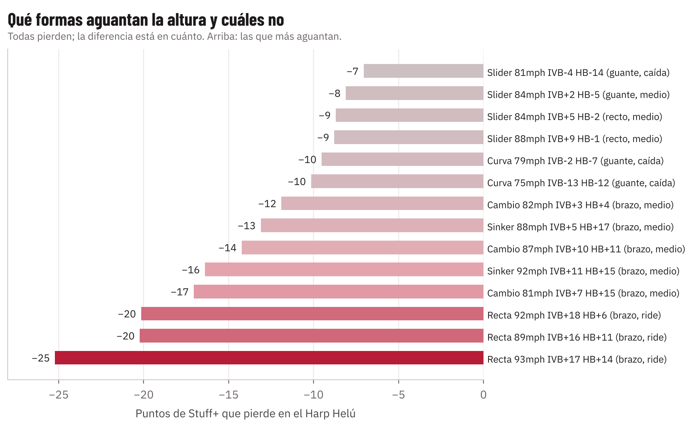
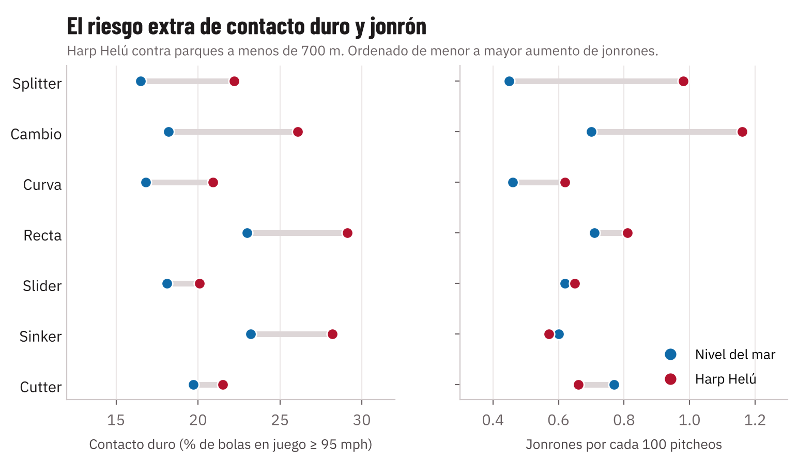
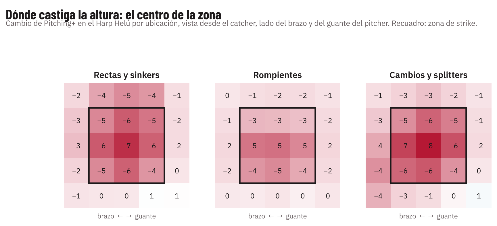
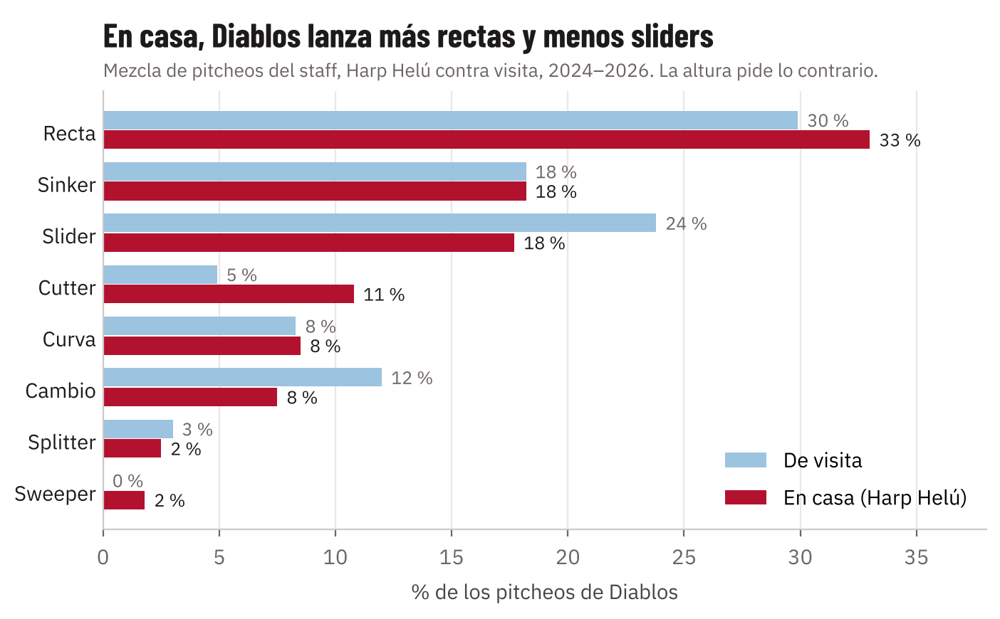
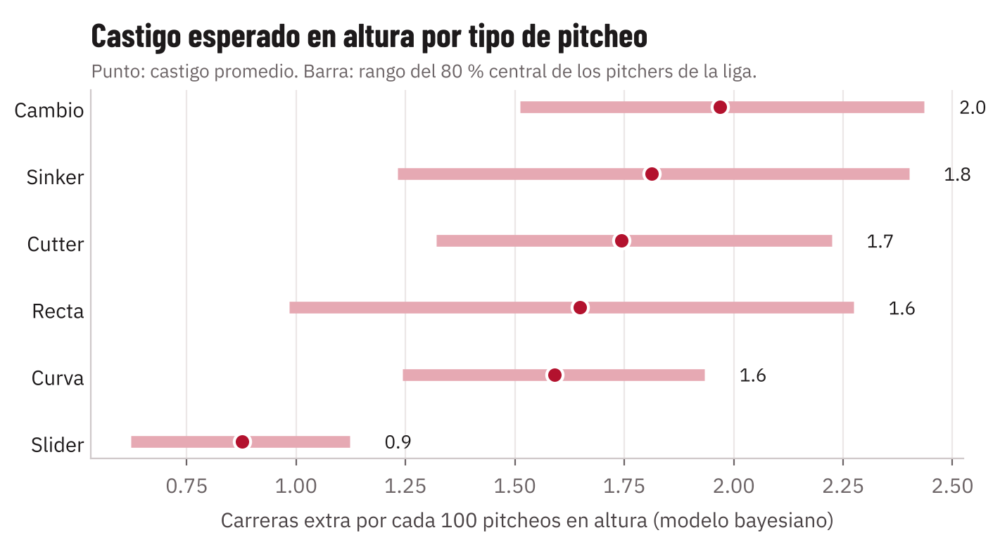

---
numero: 3
titulo: Recomendaciones operativas para el Harp Helú
pregunta: ¿Qué perfiles ganan y cuáles pierden en casa, qué riesgo de contacto duro y jonrón traen, y cómo perfilar a un prospecto o agente libre?
---

> **En 30 segundos**
>
> - **En casa ganan los rompientes y el cutter; pierden la recta de mucho bote, el sinker de mucha corrida y el cambio de mucho desvanecimiento.** El slider pierde 7 a 9 puntos; la recta de mucho bote, 20 a 25.
> - **El riesgo de jonrón en casa está en el cambio y el splitter, no en la recta.** El cambio permite 1.16 jonrones por 100 pitcheos en el Harp Helú contra 0.70 a nivel del mar. Slider y cutter casi no cambian.
> - **Diablos hace bien con el cutter en casa, pero tira menos sliders en casa que de visita (18 % contra 24 %).** Es al revés de lo que conviene. Corregirlo es la recomendación más barata de este reporte.
> - **Una ficha de cinco preguntas y un procedimiento de cinco pasos** para decidir sobre un prospecto o un agente libre con los datos del TrackMan.

## 1. Qué formas ganan y cuáles pierden en casa

El modelo no usa la etiqueta del pitcheo, sino su forma: velocidad, bote, corrida y giro. Agrupamos los pitcheos de la liga en 14 formas y medimos cuánto pierde cada una si se lanza en el Harp Helú con la misma mecánica.

| Ganan valor relativo en casa | Pierden valor relativo en casa |
|---|---|
| **Slider de caída hacia el guante** (81 mph): pierde solo 7 | **Recta de mucho bote y corrida** (93 mph, 17 in de bote): pierde 25 |
| **Sliders rectos y cutters** (84 a 88 mph): pierden 8 a 9 | **Cualquier recta de más de 16 in de bote**: pierde 20 |
| **Curvas** de cualquier velocidad: pierden 10 | **Cambio de mucho desvanecimiento** (15 in de corrida): pierde 17 |
| **Cambio firme de poca corrida** (82 mph, 4 in): pierde 12 | **Sinker de mucha corrida** (92 mph, 15 in): pierde 16 |

**La regla general:** dentro de cada tipo de pitcheo, entre más movimiento depende del giro, más se pierde en casa. Un pitcher que vive de la recta con bote o del sinker con corrida es un buen pitcher de visita y uno común en casa.

## 2. Riesgo de contacto duro y jonrón

Datos reales de la liga: lo que pasó con cada tipo de pitcheo en el Harp Helú contra los parques de menos de 700 m.

| Pitcheo | Contacto duro (95+ mph) Harp Helú | Nivel del mar | Jonrones por 100 pitcheos Harp Helú | Nivel del mar | Distancia del elevado (pies) |
|---|---|---|---|---|---|
| **Cambio** | **26.1 %** | 18.2 % | **1.16** | 0.70 | 295 contra 263 |
| **Splitter** | 22.2 % | 16.5 % | **0.98** | 0.45 | 280 contra 265 |
| Recta | 29.1 % | 23.0 % | 0.81 | 0.71 | 294 contra 260 |
| Curva | 20.9 % | 16.8 % | 0.62 | 0.46 | 280 contra 262 |
| Sinker | 28.2 % | 23.2 % | 0.57 | 0.60 | 283 contra 266 |
| Slider | 20.1 % | 18.1 % | 0.65 | 0.62 | 275 contra 257 |
| Cutter | 21.5 % | 19.7 % | 0.66 | 0.77 | 270 contra 260 |

**Qué se lee aquí:**

- **El cambio es el pitcheo más peligroso en casa.** Cuando el cambio pierde su desvanecimiento se convierte en una recta lenta: sube el contacto duro 8 puntos y casi duplica los jonrones. Lo mismo con el splitter (pocos datos, pero misma dirección).
- **La recta recibe más contacto duro** (29 %), pero sus jonrones suben poco. El elevado viaja 34 pies más, que es la diferencia entre la pista de advertencia y la barda.
- **Slider y cutter son los pitcheos más seguros en casa.** Su contacto duro y sus jonrones casi no cambian con la altura.
- **El sinker no sube en jonrones** porque su contacto va al suelo. Pierde Stuff+, pero su batazo es el menos castigado.

> **Ojo.** En el Harp Helú hay pocos cambios y splitters (3,691 y 919 pitcheos). La dirección es clara y coincide con la física, pero los porcentajes exactos tienen margen.

## 3. Dónde lanzar en casa

El mapa muestra cuánto cambia el Pitching+ en cada parte de la zona entre el Harp Helú y nivel del mar, vista desde el catcher.

- **El centro de la zona es donde más se pierde:** −7 para rectas y −8 para cambios. Un error al centro en casa cuesta más que en la costa, porque el contacto viaja más.
- **Abajo y fuera de la zona casi no se pierde nada.** Sin contacto no hay acarreo.
- **Para el cuerpo técnico:** rompientes y cambios abajo; la recta, si se usa, en las esquinas o arriba y afuera, nunca al centro.

## 4. La mezcla de Diablos en casa

| Pitcheo | En el Harp Helú | De visita | Qué conviene en casa |
|---|---|---|---|
| Recta | 33.0 % | 29.9 % | **Bajar.** Es el pitcheo que más pierde, y Diablos lo usa más en casa |
| Sinker | 18.2 % | 18.2 % | Mantener o bajar un poco |
| **Slider** | **17.7 %** | **23.8 %** | **Subir.** El que menos pierde, y Diablos lo usa menos en casa |
| Cutter | 10.8 % | 4.9 % | Bien. Ya lo usan más en casa |
| Curva | 8.5 % | 8.3 % | Subir un poco |
| Cambio | 7.5 % | 12.0 % | Bien que baje, y solo el firme y abajo |

La recomendación es mover **5 a 10 puntos de recta hacia slider y cutter en casa**. En el Harp Helú el slider promedio vale 102 de Stuff+ y la recta 88: cada 100 pitcheos que pasan de recta a slider valen cerca de **1.5 a 2 carreras menos** para el rival. Es lo máximo que se puede esperar, no lo seguro: el slider rinde en parte porque el bateador tiene que respetar la recta, así que no conviene quitarla del todo.

### Pitcher por pitcher (staff 2026)

Para cada pitcher del staff 2026 comparamos cada pitcheo de su arsenal contra su propio promedio en ambiente Harp Helú. Solo incluimos pitcheos con al menos 40 lanzamientos.

| Pitcher | Usar más en casa | Usar menos en casa | El dato que lo dice |
|---|---|---|---|
| **00078** | Slider | — | Su slider vale 120 en casa y lo usa 6 % en casa contra 25 % de visita |
| **00904** | Slider, cutter, sweeper | Recta | Usa el slider 13 % en casa contra 34 % de visita. Su recta vale 94 en casa |
| **00096** | Slider, sweeper, curva | — | Sus rompientes valen 114 a 120, pero el sinker es 72 % de su mezcla |
| **00315** | Slider | Sinker | Su slider vale 126, el mejor pitcheo del staff en casa |
| **01101** | Slider | Sinker, recta | Slider de 120; ya lo usa 30 % y puede subir |
| **00638** | Cutter, curva | Recta, sinker | Ya usa el cutter 36 % en casa. Bien |
| **00258** | Slider | Sinker | Slider de 117 contra sinker de 91 |
| **00503** | Slider | Recta, sinker | Usa el sinker 26 % en casa contra 8 % de visita: al revés |
| **00860** | Slider | Recta | Recta de 97, slider de 117 |
| **01134** | Cutter, slider, splitter | Recta, sinker | Sinker y recta valen 88 a 89 en casa |
| **00710** | Slider, curva | Recta, sinker | Sinker de 83 en casa |
| **00941** | Slider, cambio | Recta, sinker | Recta y sinker de 84 en casa |
| **01099** | Mantener | — | Ya es el perfil ideal: cutter, slider y curva todos arriba de 113 |
| **00198** | Slider | Sinker | Uso bajo del sinker; ajuste menor |

> **Qué significa para Diablos.** Casi todo el staff tiene un slider de 110 a 126 en ambiente Harp Helú, y casi todos lo usan menos en casa que de visita. No hace falta fichar a nadie para mejorar en casa: hace falta usar más lo que ya tienen.

## 5. Cuánta confianza tener en cada pitcher

Un bateador que se va de 10-5 en abril no es un bateador de .500; con pocos turnos, lo sensato es suponer que está más cerca del promedio de la liga hasta que acumule más. Hacemos lo mismo con el castigo de altura. Un modelo bayesiano jerárquico (estimado con MCMC) calcula cuánto pierde cada pitcher con cada pitcheo al subir de altura. Si el pitcher tiene pocos lanzamientos en altura, el modelo lo juzga casi como al promedio de su pitcheo; si tiene cientos, lo juzga por lo suyo.

- **El slider es el pitcheo con menos castigo y el más parejo entre pitchers:** 0.9 carreras por 100 pitcheos en promedio, y casi todos los sliders de la liga quedan entre 0.6 y 1.1.
- **Cambio, sinker y recta tienen castigos altos (1.7 a 2.0 carreras por 100) y cambian mucho de un pitcher a otro:** depende de la forma de cada uno. Ahí conviene revisar caso por caso con el simulador (anexo A).
- **Para cada pitcher, el modelo calcula la probabilidad de que su castigo pase de 3 carreras por 100 pitcheos**, que equivale a bajar unos 24 puntos de Stuff+: un pitcheo de 60 en la costa que en casa queda por debajo de 40. Es la columna que conviene ver antes de decidir quién abre en casa.

## 6. Cómo perfilar a un prospecto o agente libre

### Las cinco preguntas

| Pregunta | Dato que se necesita | Señal verde | Señal roja |
|---|---|---|---|
| **1. ¿De qué vive su recta?** | Bote vertical (IVB) y corrida (HB) | Menos de 12 in de bote, o cutter | Más de 16 in de bote: pierde 20 puntos |
| **2. ¿Tiene un rompiente de verdad?** | Giro y separación de velocidad del slider o curva | Slider de más de 2,500 rpm y 8 a 12 mph debajo de su recta | Sin rompiente, o con menos de 20 % de uso |
| **3. ¿A dónde va su contacto?** | % de rodados en bolas en juego | 50 % o más | Menos de 40 % de rodados |
| **4. ¿Cómo es su cambio?** | Corrida y separación de velocidad | Firme, poca corrida, siempre abajo | Mucha corrida y lo deja al centro: riesgo de jonrón |
| **5. ¿Ya lanzó en altura?** | Sus pitcheos en Puebla, Durango, Aguascalientes o CDMX | Su castigo observado es menor al del modelo | Pierde más de 3 carreras por 100 |

### El procedimiento

1. **Con datos de TrackMan del pitcher** (de LMB, MLB, ligas menores o una sesión de bullpen), meter cada pitcheo en el simulador: velocidad, giro, bote, corrida, release y extensión.
2. **Leer su Stuff+ en el Harp Helú y su pérdida contra nivel del mar.** Compararlo con el staff actual y con el promedio de la liga en ambiente Harp Helú.
3. **Pasarlo por las cinco preguntas.** Tres o más señales verdes es un perfil para Diablos.
4. **Si ya lanzó en altura, comparar** lo que predijo el modelo con lo que pasó. El modelo bayesiano de la sección 5 ya lo hace para los pitchers de la LMB.
5. **Ajustar el rol.** Un perfil verde con mucho volumen es abridor de casa. Un pitcher bueno pero de recta con bote se cuida para las series de visita.

> **Un ejemplo con Grandes Ligas.** Jacob Misiorowski y Chad Patrick pierden lo mismo de bote en su recta (unas 4 in), pero a Misiorowski le cuesta 5 puntos y a Patrick 12, porque 100 mph protegen la recta. La velocidad no evita la pérdida, pero deja más colchón. Por eso la pregunta 1 no se responde solo con el bote: una recta de mucho bote con velocidad de élite todavía puede servir en casa.
