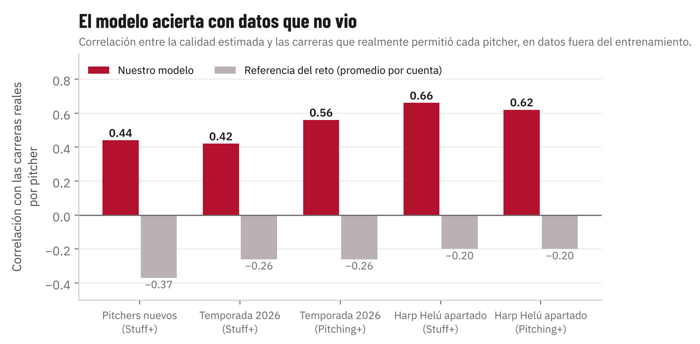
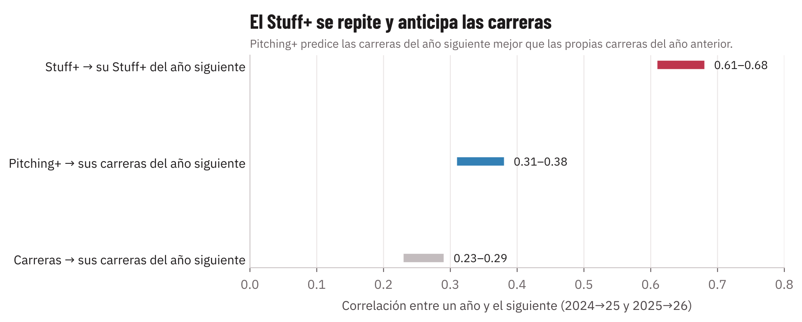

---
numero: 4
titulo: Cómo funciona el modelo y cuánto confiar en él
pregunta: ¿Qué hay detrás del Stuff+ de Diablos, cómo se validó y hasta dónde llega?
---

> **En 30 segundos**
>
> - **Este reporte es la lectura ejecutiva del documento técnico** de 10 páginas que acompaña este reporte. Explica qué decisiones se tomaron, cómo se probó el modelo y qué no puede hacer, sin necesidad de saber estadística.
> - **El modelo acierta con pitchers, temporadas y parques que no vio.** Para tener una referencia: la efectividad de un pitcher en un año apenas anticipa la del siguiente (correlación de 0.23 a 0.29). El Stuff+ y el Pitching+, con datos que nunca vieron, llegan a 0.42 a 0.66. La referencia que propone el reto ni siquiera ordena a los pitchers en la dirección correcta.
> - **El Stuff+ se sostiene de un año a otro** (0.61 a 0.68): mide al brazo, no a la suerte. Y el Pitching+ de este año anticipa las carreras del año siguiente mejor que las propias carreras de este año.
> - **El efecto de la altura se comprobó con pitchers reales:** el modelo predijo 1.5 carreras más por 100 pitcheos en altura y en el campo fueron 1.7.

## La idea en una página

**Qué medimos.** Cuántas carreras le quita cada pitcheo al rival comparado con un pitcheo promedio de la LMB. No usamos el resultado del turno, que depende mucho de la suerte y de la defensa: un roletazo débil puede colarse de hit y una línea puede ir directo al guante. Usamos el valor esperado de lo que pasa con el pitcheo: bola, strike, swing y fallo, foul o pelota en juego, y qué tan bien se le pega (velocidad de salida y ángulo).

**Cómo lo medimos.** Con tres modelos de aprendizaje automático (LightGBM). Cada uno ve distinta información, igual que un scout, un coach de pitcheo y un mánager miran cosas distintas del mismo lanzamiento:

| Modelo | Qué ve | Qué no ve, a propósito |
|---|---|---|
| **Stuff+** | La física al soltar la pelota y la altitud del parque | Ubicación, cuenta y etiqueta del pitcheo |
| **Location+** | Dónde cruzó, la cuenta y la mano de pitcher y bateador | La física |
| **Pitching+** | Todo, más el cansancio | — |

**Qué predice cada modelo.** El reto pide estimar varias probabilidades. Así las cubrimos:

| Lo que pide el reto | Cómo sale del modelo |
|---|---|
| Swing y fallo (whiff) y strike cantado | Directo: el modelo predice qué pasa con el pitcheo (bola, strike cantado, swing y fallo, foul, en juego, golpe) |
| Swing fuera de la zona (chase) | De la probabilidad de swing en los pitcheos que cruzan fuera de la zona; necesita la ubicación, así que sale de Pitching+ |
| Rodado | Directo: probabilidad de rodado cuando hay contacto |
| Contacto duro o barril | Directo como contacto de 95 mph o más; no usamos la definición estricta de barril |
| Contacto débil | Dentro del valor esperado del contacto, que se calcula con velocidad de salida y ángulo |
| Out en el turno | Ponche más out en bola en juego |
| Valor esperado en carreras (xRunValue) | Es el número que se convierte en Stuff+ |

**Cómo metimos la altura.** De dos formas que se complementan:

1. **La altitud entra como dato** al modelo, así que aprende cuánto vale el mismo pitcheo en cada parque.
2. **Un traslado físico del movimiento.** Medimos a los mismos pitchers en parques bajos y altos y calculamos cuánto bote y cuánta corrida pierde cada tipo de pitcheo por cada kilómetro de altura. Así podemos llevar cualquier pitcheo al Harp Helú o a nivel del mar y comparar.

**La escala.** 100 es el promedio de la LMB, como en ERA+ u OPS+; la escala completa está en el reporte 1.

## Seis decisiones que vale la pena conocer

| Decisión | Por qué |
|---|---|
| **No usar la etiqueta del pitcheo** | El clasificador llama "slider" a cuatro formas distintas con Stuff+ de 106 a 112. El modelo califica cómo se mueve la pelota, no cómo se llama |
| **Comparar cada pitcheo contra la recta del mismo pitcher** | Un cambio vale por lo que se separa de la recta en velocidad y movimiento; solo no dice mucho |
| **Calcular nuestros propios valores de carrera para la LMB** | La LMB produce más carreras que MLB, así que un out o un sencillo valen distinto, y la altura cambia cuánto vale cada batazo |
| **Quitar el fildeo** | El valor del batazo se calcula con velocidad de salida y ángulo, no con si el fildeador lo atrapó |
| **El 100 se ajusta por temporada, no por estadio** | El reto propone ajustar por temporada y estadio. Ajustamos por temporada (cada año tiene su propio 100), pero no por estadio, a propósito: si cada parque tuviera su propio 100, el efecto de la altura desaparecería del número. Para comparar a todos en la misma cancha usamos el ranking en *ambiente Harp Helú*, que sí pone a todos en el mismo parque |
| **Agregar un modelo bayesiano (MCMC)** | Para que un pitcher con pocos pitcheos en altura no reciba un castigo extremo por pura suerte, igual que no se juzga a un bateador por 20 turnos |

## Cómo sabemos que funciona

Probamos el modelo de tres formas, siempre con datos que no usó para aprender. La medida es la correlación entre lo que el modelo esperaba de cada pitcher (con 200 pitcheos o más) y las carreras que en realidad permitió: 1 sería acertar siempre, 0 sería tirar una moneda.

- **Pitchers nuevos.** Como calificar a un pitcher que acaba de llegar a la liga: entrenamos con el 85 % de los pitchers y calificamos al 15 % que el modelo nunca vio lanzar. Stuff+: 0.44. Esta prueba se corrió solo para Stuff+.
- **Temporada nueva.** Como hacer las proyecciones en el spring training: entrenamos con 2024 y 2025 y pronosticamos 2026. Stuff+ 0.42 y Pitching+ 0.56.
- **El Harp Helú apartado.** Entrenamos sin ningún pitcheo del Harp Helú y calificamos los que se lanzaron ahí (35 pitchers). Stuff+ 0.66 y Pitching+ 0.62. Es la prueba más importante para Diablos: el modelo funciona en su parque sin haberlo visto.

**La referencia del reto** le pone a cada pitcheo el valor promedio de la cuenta en que se lanzó. Sabe si el pitcher iba 3-0 o 0-2, pero no cómo es la bola. Por eso no separa a un pitcher bueno de uno malo: por pitcher, su correlación con las carreras reales sale negativa (−0.26 en 2026 y −0.20 en el Harp Helú), es decir, ni siquiera los ordena en la dirección correcta.

**Error en carreras.** Por pitcher, la referencia del reto se equivoca en promedio por 1.84 carreras por cada 100 pitcheos al estimar lo que permitió en 2026. El Stuff+ baja ese error a 1.75 y el Pitching+ a 1.59. Pitcheo por pitcheo la diferencia es mínima (el Stuff+ casi empata con la referencia), porque un pitcheo suelto es casi pura suerte.

**Estabilidad.** El Stuff+ de un pitcher se repite de un año a otro (0.61 a 0.68), mucho más que sus carreras permitidas (0.23 a 0.29). Y el Pitching+ de este año predice las carreras del año siguiente (0.31 a 0.38) mejor que las propias carreras de este año. **Para firmar o renovar, el Pitching+ dice más que la efectividad.**

**El efecto altitud, comprobado.** Tomamos 150 pitchers que lanzaron tanto arriba de 1,800 m como abajo de 700 m. El modelo predijo que en altura permitirían 1.5 carreras más por 100 pitcheos; en la realidad fueron 1.7.

**Calibración: el modelo no exagera ni se queda corto.** Cuando el Pitching+ dice que un grupo de pitcheos vale 5 carreras, en el campo valió 5: la relación entre lo esperado y lo real es 1.00 en la temporada nueva y 0.99 en el Harp Helú apartado (1.00 es lo ideal). El Stuff+ da 0.95 en la temporada nueva, pero 1.30 en el Harp Helú apartado: ahí las diferencias reales entre pitcheos buenos y malos fueron cerca de 30 % más grandes que lo que esperaba el modelo. Lo leemos como que el Stuff+ ordena bien en casa, pero se queda corto en el tamaño de la diferencia.

## Las cuatro hipótesis del reto

| Hipótesis | Resultado | Evidencia, en términos de béisbol |
|---|---|---|
| **H1.** En altura hay menos movimiento por giro | **Se confirma** | El mismo pitcher pierde 4.8 pulgadas de bote en la recta en el Harp Helú; el giro y la velocidad no cambian. La recta "sube" menos |
| **H2.** El cambio gana valor relativo | **No se cumple** | Pierde menos que la recta (−15 contra −22), pero más que los rompientes, y le batean más fuerte: el contacto duro sube de 18 % a 26 % y los jonrones, de 0.70 a 1.16 por cada 100 cambios |
| **H3.** Los pitchers de rodados valen más | **Se confirma** | En casa, un elevado vale casi el doble de carreras extra que un rodado; los pitchers de rodados son los que suben en el ranking |
| **H4.** El giro solo no basta | **Se confirma** | Con solo velocidad y giro, el modelo acierta la mitad de lo que acierta con la forma completa del pitcheo. Importa cómo se mueve, no cuánto gira |

## Hasta dónde llega el modelo

- **Un pitcheo suelto dice poco.** A nivel de un solo pitcheo el Stuff+ mejora apenas 1.5 % sobre adivinar siempre lo mismo. Es normal: en MLB pasa lo mismo. El valor aparece al juntar cientos de pitcheos, por eso las decisiones de estos reportes usan promedios por pitcher y por tipo de pitcheo.
- **Las pruebas con datos nuevos tienen huecos.** La prueba con pitchers nuevos solo se corrió para Stuff+, no para Location+ ni Pitching+. La prueba por parque solo apartó al Harp Helú, no a cada estadio de la liga.
- **Hay datos que el reto sugiere y no usamos:** el efecto túnel (qué tan parecido sale cada pitcheo del mismo punto que la recta), el porcentaje de uso de cada pitcheo, el pitcheo anterior en la secuencia, la entrada y los corredores en base. El modelo sí compara cada pitcheo contra la recta del pitcher en velocidad, bote, corrida y eje de giro.
- **El Harp Helú y los equipos se identificaron por récord.** Los datos vienen anónimos y solo dicen si el parque es de altura baja, media o extrema. Diablos es el equipo con mejor récord en 2024 y 2025, y su parque de casa coincide con el Harp Helú. La altitud de cada parque es la del estadio que identificamos. Es muy probable, pero ISAC no lo confirmó.
- **El cambio y el slider pierden en altura más movimiento del que explica solo el aire.** Puede haber efectos de costura, de qué pitchers lanzan en altura o de cómo se calibra el TrackMan en cada parque. El modelo usa lo medido, no lo teórico.
- **Pocos datos de splitter.** Sus cifras tienen más margen que las del resto.
- **No hay datos de clima.** Temperatura, humedad y viento cambian la densidad del aire de un día a otro; el modelo usa la altitud del parque como promedio.

## Qué sigue

1. **Agregar el clima del día** para ajustar la densidad del aire por juego.
2. **Agregar el efecto túnel, el uso de cada pitcheo y la secuencia**, y repetir la prueba de pitchers nuevos para Location+ y Pitching+.
3. **Actualizar los scores cada mes** durante la temporada 2027, para seguir al staff y a los candidatos.
4. **Conectar el simulador con los datos de TrackMan del bullpen**, para calificar sesiones de práctica.
