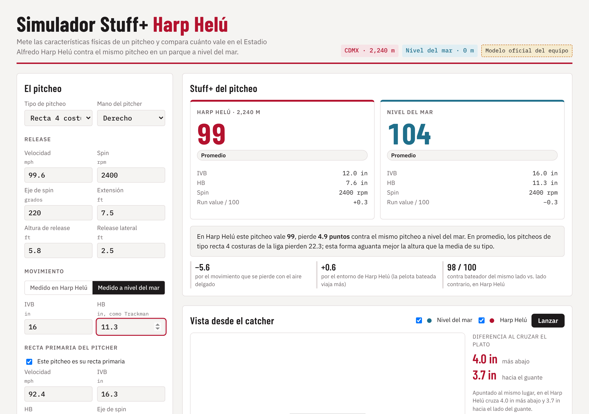
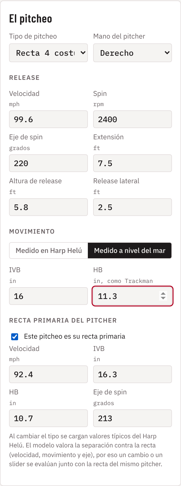
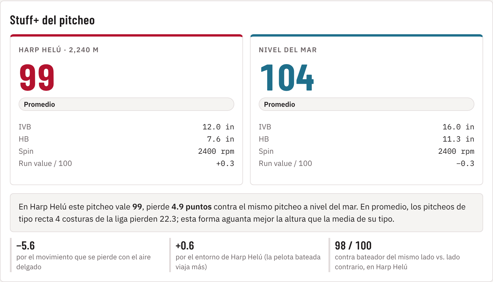
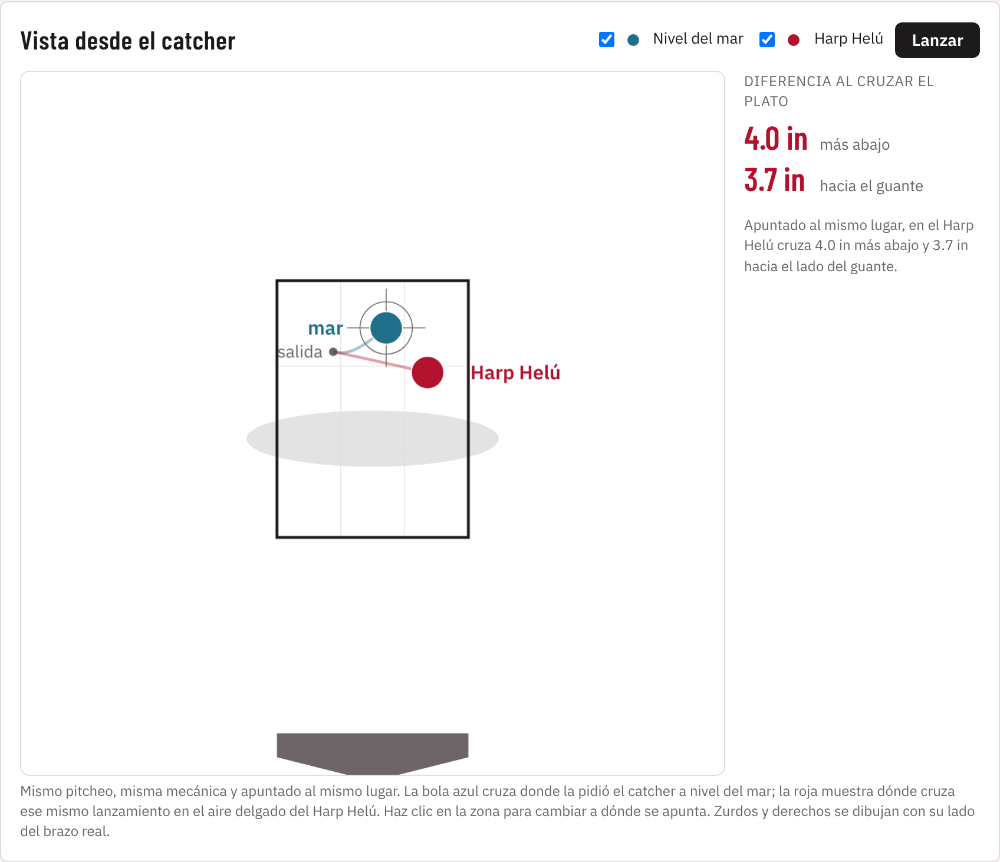
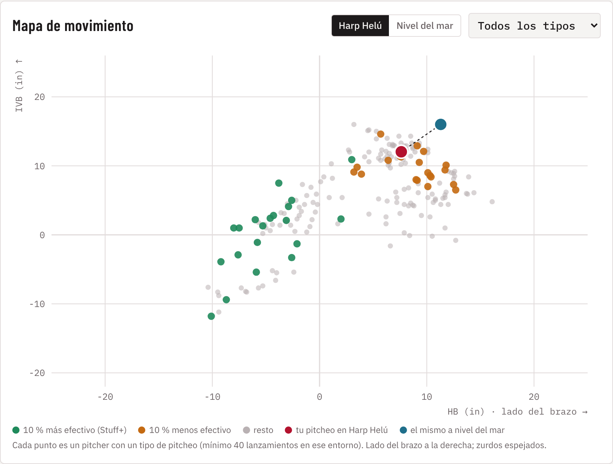

---
numero: 5
etiqueta: A
titulo: Simulador Stuff+ Harp Helú: cómo funciona y cómo se usa
pregunta: ¿Cómo se usa la herramienta para comparar un pitcheo en el Harp Helú contra nivel del mar y tomar decisiones con ella?
---

> **En 30 segundos**
>
> - **El simulador responde una pregunta: ¿cuánto vale este pitcheo en casa?** Se meten los datos de TrackMan de un pitcheo y devuelve su Stuff+ en el Harp Helú y a nivel del mar, cuánto pierde y por qué.
> - **Tres vistas:** el score lado a lado, la vista desde el catcher (dónde cruza el mismo lanzamiento en cada parque) y el mapa de movimiento contra toda la liga.
> - **Usa el mismo modelo de los reportes 1 a 4.** No es una aproximación aparte: es el modelo final del equipo dentro de una página.
> - **Funciona en el navegador, sin instalar nada**, en computadora o celular: <https://claude.ai/artifact/KYU5KNKmTSzew9CFQMMRhd>. También hay una copia en un solo archivo HTML que abre sin internet.

## Para qué sirve

| Quién | Pregunta | Qué mirar en el simulador |
|---|---|---|
| **Dirección deportiva** | ¿Fichamos a este pitcher para casa? | Stuff+ en el Harp Helú de cada pitcheo de su arsenal, y cuánto pierde contra nivel del mar |
| **Coach de pitcheo** | ¿Qué pitcheo usar más en casa? | El pitcheo que menos pierde y el que queda más alto en el Harp Helú |
| **Mánager** | ¿Quién abre en casa y quién de visita? | La diferencia entre los dos scores: el que más pierde, mejor de visita |
| **Scouting** | ¿Este prospecto aguanta la altura? | Su forma contra la liga en el mapa de movimiento |

## Paso 1: meter el pitcheo

Todos los datos salen directamente de un reporte de TrackMan o Hawk-Eye:

- **Tipo de pitcheo y mano del pitcher.** El tipo solo sirve para comparar contra la media de su tipo; el modelo califica la forma, no la etiqueta.
- **Release:** velocidad, giro, eje de giro, extensión, altura y posición lateral de salida.
- **Movimiento:** bote vertical (IVB) y corrida (HB). Hay que indicar dónde se midió, en el Harp Helú o a nivel del mar, y el simulador traslada el movimiento al otro parque con la física de la altura.
- **Recta primaria del pitcher.** El modelo compara cada pitcheo contra la recta del mismo pitcher (separación de velocidad y de movimiento). Si el pitcheo es la recta, se marca la casilla.

## Paso 2: leer el resultado

En este ejemplo metimos la recta de Jacob Misiorowski (99.6 mph, 16 in de bote medido a nivel del mar):

- **Las dos tarjetas** dan el Stuff+ en el Harp Helú (99) y a nivel del mar (104), con su etiqueta en la escala del reporte 1 y el movimiento en cada parque. Pierde 4 in de bote y 3.7 de corrida.
- **El texto de abajo** dice cuánto pierde (4.9 puntos) y lo compara con la media de su tipo: las rectas de la liga pierden 22. Esta aguanta mejor por su velocidad.
- **Los tres números chicos** separan la pérdida: cuánto viene del movimiento que quita el aire delgado, cuánto del entorno del parque, y cómo le va contra bateadores del mismo lado y del lado contrario.

## Paso 3: ver dónde cruza el plato

Esta es la vista para el cuerpo técnico. El mismo lanzamiento, con la misma mecánica y apuntado al mismo lugar: la bola azul cruza donde la pidió el catcher a nivel del mar y la roja muestra dónde cruza en el Harp Helú.

- **En este ejemplo la recta cruza 4 in más abajo y 3.7 in hacia el guante.** Una recta que arriba de la zona saca swings y fallos en la costa, en casa cae a la altura del bate.
- **Se puede hacer clic en la zona** para cambiar a dónde se apunta, y el botón *Lanzar* repite la animación.
- **Sirve para explicar al pitcher** por qué su recta "no sube" en casa, con una imagen que entiende en segundos.

## Paso 4: compararlo con la liga

Cada punto es un pitcher de la LMB con un tipo de pitcheo. Los verdes son el 10 % más efectivo de la liga y los naranjas el 10 % menos efectivo. El punto azul es el pitcheo a nivel del mar y el rojo el mismo pitcheo en el Harp Helú.

**Qué se lee aquí:** en el Harp Helú la recta de Misiorowski se mueve hacia el centro del grupo de rectas, que es la zona naranja. A nivel del mar estaba en una orilla del grupo, que es donde está el valor. El filtro de arriba deja ver solo un tipo de pitcheo.

## Tres casos de uso

**Caso 1. Evaluar a un agente libre.** Meter cada pitcheo de su arsenal con sus datos de TrackMan. Si su mejor pitcheo en el Harp Helú pasa de 107 y su peor pitcheo no baja de 93, es un pitcher que funciona en casa. Pasarlo después por las cinco preguntas del reporte 3.

**Caso 2. Ajustar la mezcla de un pitcher del staff.** Meter su recta y su slider. Si la recta pierde 15 o más y el slider menos de 10, conviene subir el slider en casa. Es el caso de casi todo el staff 2026 (reporte 3).

**Caso 3. Preparar una junta con el pitcher.** Abrir la vista desde el catcher con su propia recta y mostrar dónde cruza en casa. Es la forma más rápida de que acepte un cambio de plan.

## Lo que el simulador no hace

- **No predice el resultado de un turno.** Califica la calidad física del pitcheo. Un solo pitcheo de 110 puede terminar en jonrón; el valor aparece en promedio.
- **No toma en cuenta la ubicación.** Para eso está el Location+ del reporte 1. El simulador mide el brazo, no el comando.
- **Los pitcheos raros tienen más margen.** Si una forma casi no existe en la LMB (por ejemplo, una recta de 100 mph), el modelo tiene pocos ejemplos parecidos y su score es menos preciso.
- **Los datos de Grandes Ligas se traducen, no se copian.** Los TrackMan de MLB miden a la altura de cada parque; hay que marcar *Medido a nivel del mar* para los parques bajos.

## Cómo abrirlo

- **En línea:** <https://claude.ai/artifact/KYU5KNKmTSzew9CFQMMRhd>
- **Sin internet:** el archivo `simulador_standalone.html` que acompaña este reporte. Se abre con doble clic en cualquier navegador.
