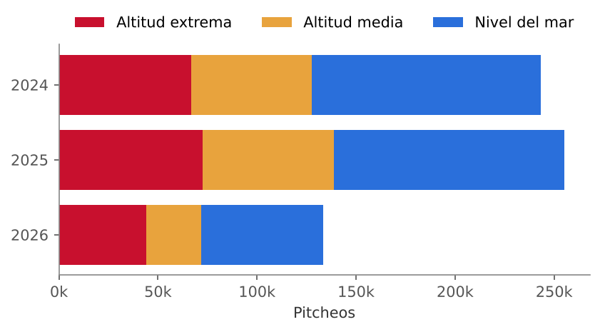
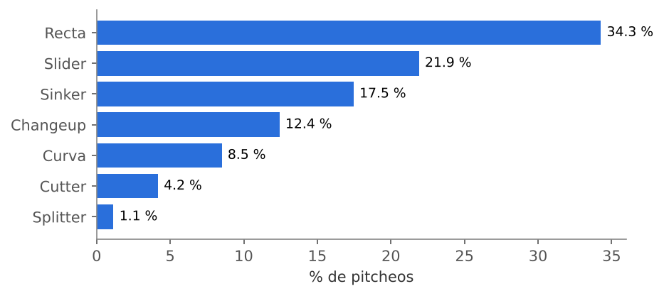
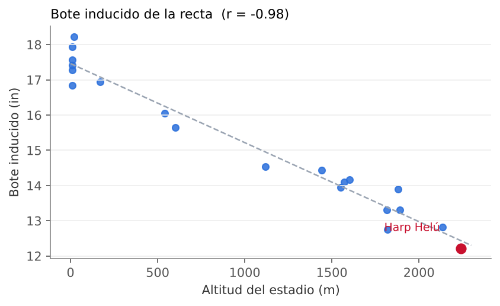
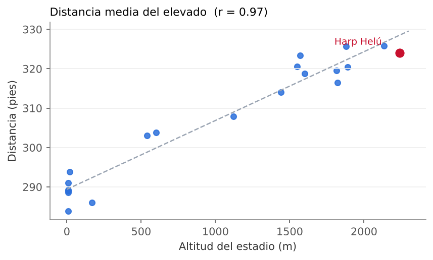
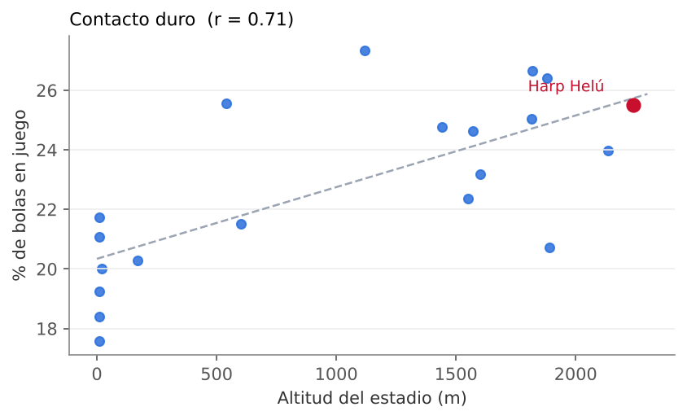
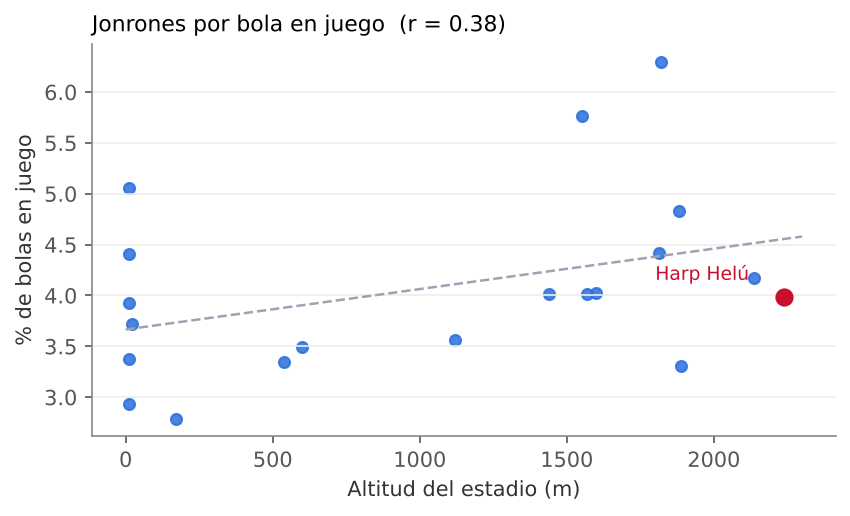
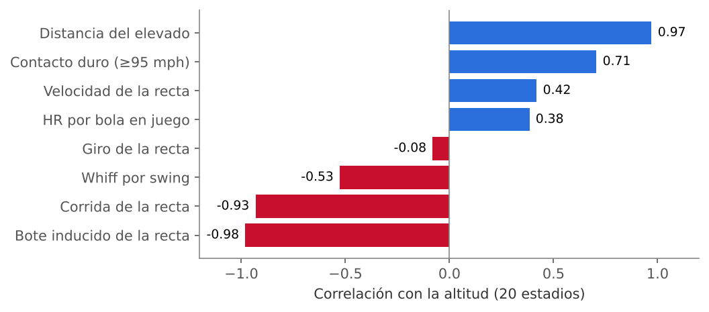
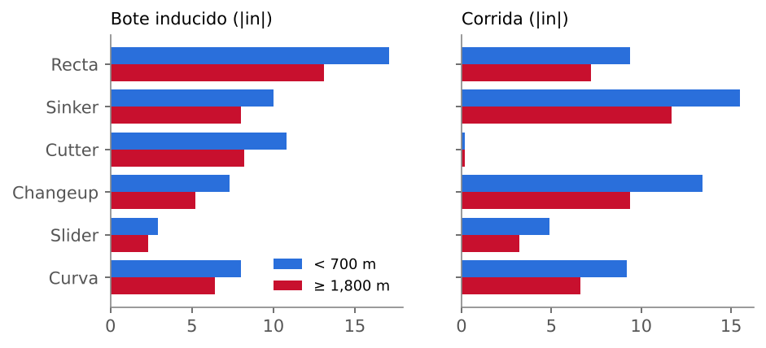

# EDA: datos LMB y efecto de la altitud

Hackathon Diablos Rojos · Stuff+ calibrado al Estadio Alfredo Harp Helú (2,240 m) · 18 de octubre de 2026

## En una página

- Antes de cualquier modelo, los datos ya muestran el efecto de la altitud: entre más alto el estadio, **menos se mueve la recta** (r = −0.98) y **más lejos vuela el elevado** (r = 0.97).
- La recta pasa de ~17.5 pulgadas de bote inducido en la costa a 12.2 en el Harp Helú; el elevado promedio, de ~289 a 324 pies.
- La velocidad y el giro casi no cambian con la altitud (r = 0.42 y −0.08). La pelota sale igual; lo que cambia es cuánto la empuja el aire (efecto Magnus).
- El contacto duro sube con la altitud (r = 0.71), pero los jonrones por bola en juego casi no (r = 0.38).
- Estas observaciones definen el modelo: altitud continua en metros, forma completa del pitcheo en vez de solo giro, y una cabeza aparte para el valor del contacto.

## 1. Los datos

| Pitcheos Trackman | Juegos | Pitchers | Bateadores | Estadios |
|---|---|---|---|---|
| 635,002 | 2,127 | 1,134 | 864 | 20 |

Tres temporadas de la LMB (2024, 2025 y 2026 parcial). Cerca de la mitad de los pitcheos se lanzó en parques con altitud, lo que permite comparar al mismo pitcher en distintos entornos.

| Temporada | Altitud extrema | Altitud media | Nivel del mar | Total |
|---|---|---|---|---|
| 2024 | 66,619 | 60,934 | 115,701 | 243,254 |
| 2025 | 72,720 | 65,981 | 116,496 | 255,197 |
| 2026 (parcial) | 43,928 | 27,925 | 61,678 | 133,531 |

## 2. Mezcla de pitcheos

Recta 34.3 %, slider 21.9 %, sinker 17.5 %, changeup 12.4 %, curva 8.5 %, cutter 4.2 %, splitter 1.1 %. El clasificador casi no usa «Sweeper» (0.1 %), así que los sweepers quedan dentro de «Slider». Por eso el modelo mira la forma del pitcheo y no la etiqueta.

## 3. Calidad de datos

- No hay ID de estadio, solo la categoría de altitud. El estadio de cada juego se infirió por equipo local (récords 2024-2025 y altitud de la ciudad); el Harp Helú es la casa del equipo con mejor récord. Es una inferencia, no un dato confirmado por ISAC.
- No hay corredores en base, fecha, umpire ni clima. Por eso el valor en carreras se calcula por cuenta y no con RE24.
- `is_hit_by_pitch` viene siempre en 0 aunque hay golpeados; se recalcula desde PitchCall.
- 6,669 pitcheos con PlateLocHeight = 0 exacto (se tratan como faltantes), 3,272 sin ID de pitcher y 2,834 sin estadio asignado.
- `EffectiveVelo` llega como texto y se convierte a número.

## 4. La altitud en crudo, por estadio

La relación de los jonrones es débil: el exceso de ofensiva en altura viene más de hits que de jonrones (en línea con Richardson, 2014).

| Métrica | Correlación con la altitud |
|---|---|
| Bote inducido de la recta | −0.98 |
| Distancia del elevado | 0.97 |
| Corrida de la recta | −0.93 |
| Contacto duro (≥95 mph) | 0.71 |
| Whiff por swing | −0.53 |
| Velocidad de la recta | 0.42 |
| HR por bola en juego | 0.38 |
| Giro de la recta | −0.08 |

### Tabla por estadio

| Estadio | Altitud (m) | Pitcheos | IVB recta (in) | HB recta (in) | Velo recta (mph) | Giro recta (rpm) | Contacto duro % | Dist. elevado (ft) | HR/BIP % | Whiff/swing % |
|---|---|---|---|---|---|---|---|---|---|---|
| Estadio Beto Ávila | 10 | 27,839 | 17.6 | 9.8 | 90.9 | 2,335 | 19.2 | 284 | 3.9 | 26.2 |
| Estadio Nelson Barrera | 10 | 32,199 | 17.9 | 9.8 | 90.6 | 2,344 | 17.6 | 289 | 5.1 | 26.6 |
| Parque Deportivo Veracruzano | 10 | 33,347 | 17.3 | 9.5 | 91.3 | 2,365 | 18.4 | 289 | 4.4 | 24.0 |
| Parque Centenario 27 de Febrero | 10 | 28,401 | 17.4 | 9.0 | 92.1 | 2,364 | 21.7 | 289 | 3.4 | 23.8 |
| Parque Kukulcán | 10 | 33,983 | 16.9 | 8.7 | 91.0 | 2,337 | 21.1 | 291 | 2.9 | 23.1 |
| Estadio Chevron | 20 | 34,168 | 18.2 | 9.9 | 91.7 | 2,305 | 20.0 | 294 | 3.7 | 28.7 |
| Estadio Nuevo Laredo | 170 | 36,005 | 16.9 | 9.6 | 92.2 | 2,330 | 20.3 | 286 | 2.8 | 25.1 |
| Estadio Mobil Super | 540 | 37,373 | 16.1 | 9.6 | 92.2 | 2,328 | 25.6 | 303 | 3.4 | 23.0 |
| Estadio Monclova | 600 | 31,634 | 15.7 | 8.3 | 92.1 | 2,168 | 21.5 | 304 | 3.5 | 22.8 |
| Estadio Revolución | 1,120 | 38,761 | 14.5 | 7.6 | 92.1 | 2,355 | 27.4 | 308 | 3.6 | 23.7 |
| Estadio Monumental | 1,440 | 21,991 | 14.4 | 7.6 | 91.4 | 2,317 | 24.8 | 314 | 4.0 | 24.1 |
| Estadio Eduardo Vasconcelos | 1,550 | 33,622 | 13.9 | 7.3 | 92.1 | 2,335 | 22.4 | 321 | 5.8 | 24.9 |
| Estadio Panamericano | 1,570 | 31,712 | 14.1 | 7.5 | 91.7 | 2,327 | 24.6 | 323 | 4.0 | 24.4 |
| Estadio Francisco I. Madero | 1,600 | 29,087 | 14.2 | 7.6 | 91.6 | 2,339 | 23.2 | 319 | 4.0 | 22.7 |
| Estadio Domingo Santana | 1,815 | 35,273 | 13.3 | 7.0 | 92.1 | 2,316 | 25.0 | 320 | 4.4 | 23.4 |
| Estadio Querétaro | 1,820 | 10,156 | 12.8 | 6.8 | 91.5 | 2,314 | 26.6 | 317 | 6.3 | 22.4 |
| Parque Alberto Romo Chávez | 1,880 | 28,572 | 13.9 | 7.5 | 92.0 | 2,333 | 26.4 | 326 | 4.8 | 21.9 |
| Estadio Francisco Villa | 1,890 | 35,394 | 13.3 | 7.2 | 91.7 | 2,328 | 20.7 | 320 | 3.3 | 24.7 |
| Estadio Hermanos Serdán | 2,135 | 33,330 | 12.8 | 7.3 | 92.0 | 2,349 | 24.0 | 326 | 4.2 | 22.5 |
| **Estadio Alfredo Harp Helú** | 2,240 | 39,321 | 12.2 | 6.9 | 92.2 | 2,285 | 25.5 | 324 | 4.0 | 23.2 |

Corrida (HB) con zurdos espejados.

## 5. Por tipo de pitcheo

En parques de 1,800 m o más todos los pitcheos se mueven menos que en parques de menos de 700 m, mientras la velocidad y el giro no cambian. Son promedios crudos que mezclan pitchers distintos; el modelo compara al mismo pitcher.

| Pitcheo | IVB alto / bajo (in) | HB alto / bajo (in) | Velo alto / bajo (mph) | Giro alto / bajo (rpm) |
|---|---|---|---|---|
| Recta | 13.1 / 17.1 | 7.2 / 9.4 | 92.0 / 91.6 | 2,321 / 2,320 |
| Sinker | 8.0 / 10.0 | 11.7 / 15.5 | 91.4 / 91.1 | 2,266 / 2,246 |
| Cutter | 8.2 / 10.8 | 0.2 / 0.2 | 88.6 / 88.3 | 2,355 / 2,425 |
| Changeup | 5.2 / 7.3 | 9.4 / 13.4 | 83.0 / 83.4 | 1,835 / 1,802 |
| Slider | 2.3 / 2.9 | −3.2 / −4.9 | 84.0 / 83.3 | 2,432 / 2,398 |
| Curva | −6.4 / −8.0 | −6.6 / −9.2 | 77.8 / 77.5 | 2,545 / 2,519 |

La recta pierde 4 pulgadas de bote; el sinker y el changeup, 4 de corrida. El slider pierde poco en pulgadas porque se mueve poco desde el inicio.

## 6. Qué decisiones del modelo salen del EDA

| Lo que muestra el EDA | Decisión de modelado |
|---|---|
| El movimiento cae de forma continua con la altitud (r = −0.98 en la recta), no solo en el Harp Helú | La altitud entra como variable continua en metros |
| Velocidad y giro no cambian; el movimiento sí | Se modela la forma completa (movimiento, eje, separación con la recta) y no solo el giro (H4) |
| El elevado viaja ~35 pies más arriba de 1,800 m | Una cabeza aparte para el valor del contacto según velocidad, ángulo y altitud (H3) |
| Los pitchers lanzan en varios entornos | Comparaciones dentro del mismo pitcher y un modelo bayesiano jerárquico (MCMC) que usa su historia en altura |
| El clasificador mete sweepers en «Slider» | Stuff+ no recibe la etiqueta del tipo, solo la forma |
| No hay corredores ni estadio | Valor en carreras por cuenta; estadio inferido por equipo local |

Código: `eda_altitud.py` (cálculos) y `construir_reporte_eda.py` (este reporte en HTML, con las gráficas). Todos los CSV están en esta carpeta.
