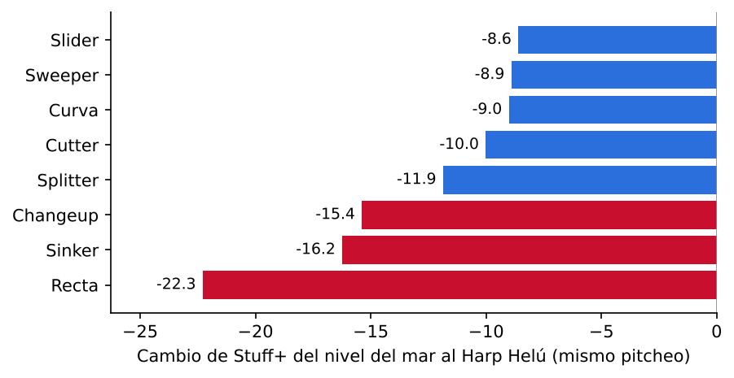
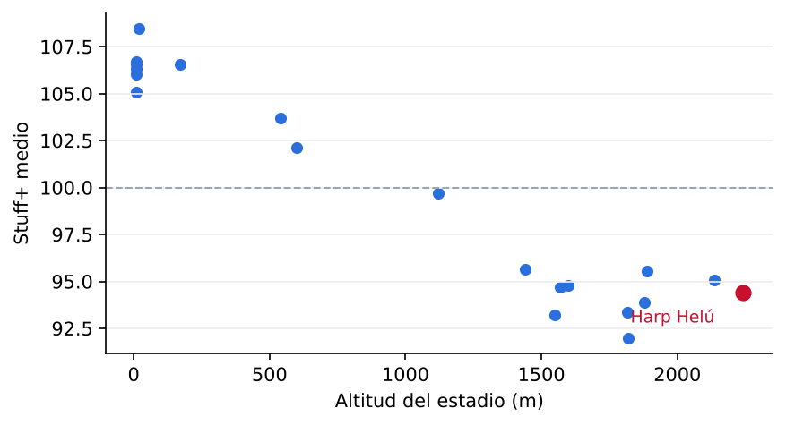
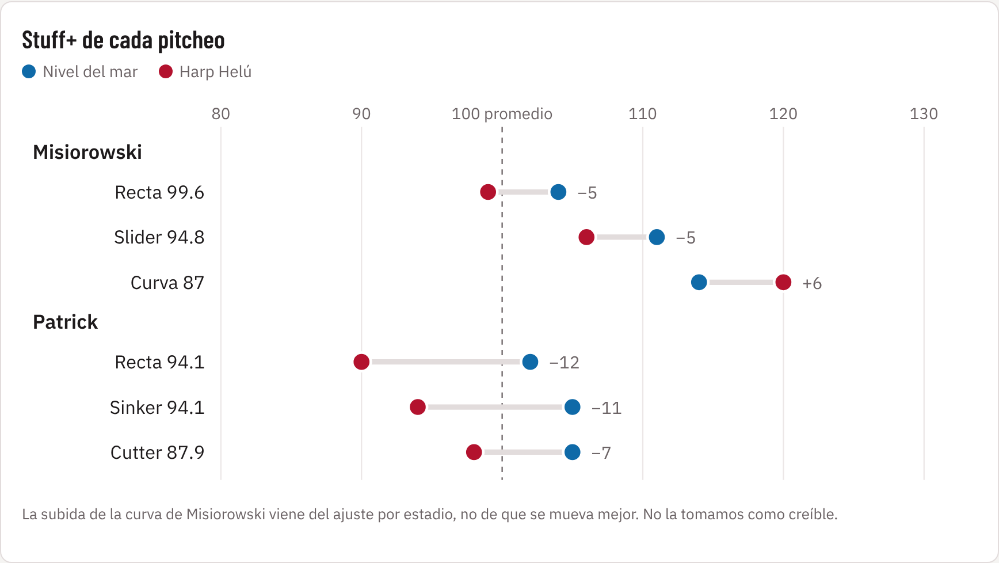
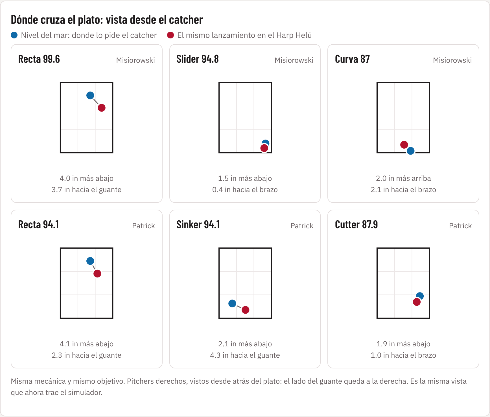
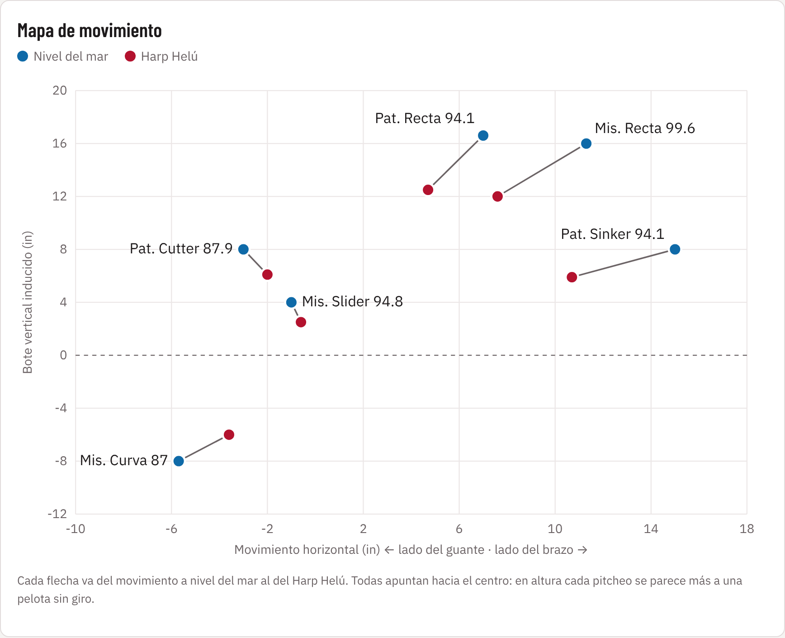

# Stuff+ en el Harp Helú: qué cambia para los Diablos

Octubre 2026

**Equipo:** Paulina Garza Allende, Othoniel Reyes Camacho, Andrea Guerra y Jose Rodrigo Dumas Avalos

A 2,240 metros el aire es cerca de 20 % menos denso que al nivel del mar, y eso le quita al pitcheo justo lo que lo hace difícil de batear: el movimiento que produce el giro de la pelota. No todos los pitcheos lo resienten igual. Una recta que vive de "subir" pierde casi una cuarta parte de su bote en el Harp Helú, mientras que un slider también pierde movimiento, pero su valor depende poco de él: vive de la diferencia de velocidad y del ángulo con que llega al plato. Este reporte traduce esa diferencia en decisiones: qué lanzar en casa, dónde ubicarlo, a quién subir al montículo y a quién contratar.

## Qué medimos y por qué confiar en los números

Stuff+ responde una pregunta concreta: si este pitcheo, con esta velocidad, este giro y este movimiento, se lanzara mil veces, ¿cuántas carreras le quitaría al rival? Lo calculamos con 629,616 pitcheos Trackman de la LMB entre 2024 y 2026. La escala se lee como ERA+ u OPS+: 100 es un pitcheo promedio de la liga y más alto siempre es mejor para el pitcher. Un 110 está arriba del 84 % de la liga, 120 o más es élite (el 3 % mejor) y 80 o menos es nivel de reemplazo. Para el scout, Stuff+ menos 50 da el grado en la escala 20–80: un 110 es un pitcheo de 60. En carreras, 10 puntos de Stuff+ son alrededor de 1.3 carreras por cada 100 pitcheos, más o menos una salida larga de abridor.

Usamos tres lecturas del mismo pitcheo. **Stuff+** mira solo la física al soltar la pelota, sin saber dónde cruzó ni en qué cuenta. **Location+** mira solo la ubicación y la cuenta. **Pitching+** junta ambas. Detrás hay 15 modelos de gradient boosting (LightGBM) que predicen por separado la probabilidad de swing y fallo, strike cantado, rodado, contacto duro y out, y luego lo convierten a carreras.

La prueba que importa es si el modelo acierta con información que no vio, como hacer las proyecciones en el spring training. Entrenamos con 2024 y 2025 y pronosticamos 2026: Pitching+ por pitcher tiene una correlación de 0.56 con las carreras que realmente permitió (1 sería acertar siempre; 0, tirar una moneda). La referencia del reto, que solo sabe en qué cuenta se lanzó cada pitcheo y no cómo es la bola, ni siquiera ordena a los pitchers en la dirección correcta (−0.26). El Stuff+ también acierta con pitchers que el modelo nunca vio (0.44) y con el Harp Helú apartado del entrenamiento (0.66). Y algo más útil para un scout: el Stuff+ de un pitcher se repite de un año a otro (0.61 a 0.68), mucho más que su efectividad (0.23 a 0.29). Pitching+ predice las carreras del año siguiente mejor que las propias carreras del año anterior. Es decir, el modelo ve la calidad del brazo antes de que aparezca en la tabla.

*Cambio de Stuff+ del mismo pitcheo evaluado al nivel del mar y en el Harp Helú. Fuente: 01_scores/delta_altitud_por_tipo.csv (629,616 pitcheos, 2024-2026).*

*Stuff+ medio de los pitcheos lanzados en cada uno de los 20 estadios. Fuente: 01_scores/scores_por_estadio.csv.*

El efecto no es exclusivo de la Ciudad de México: todos los parques arriba de 1,400 m bajan el Stuff+ medio a la zona de 92 a 96, contra 105 a 108 en los parques de la costa. Lo que distingue al Harp Helú es que los Diablos juegan ahí la mitad de su temporada, así que para ellos esto no es un ajuste ocasional sino la condición normal de trabajo. Como validación, en 150 pitchers que lanzaron arriba de 1,800 m y abajo de 700 m, el modelo predice que permiten 1.5 carreras más por cada 100 pitcheos en altura, y en la realidad permitieron 1.7.

## Lo que la altura le hace a un pitcheo

El movimiento "inducido" de un pitcheo (el bote de la recta, la corrida del sinker, la caída lateral del changeup) viene de la fuerza Magnus: la pelota gira y empuja el aire hacia un lado. Con menos aire hay menos empuje. Comparando a los mismos pitchers en el Harp Helú y al nivel del mar, la recta pierde 4.8 pulgadas de bote y 3.4 de corrida; el changeup pierde 5 de corrida. La velocidad y el giro no cambian. Lo que cambia es lo que el giro logra.

La consecuencia es que en altura todos los pitcheos se parecen más a una pelota sin movimiento, y el pitcheo que más dependía de moverse es el que más pierde. Un slider o una curva viven de la diferencia de velocidad con la recta y de un ángulo de llegada que el bateador no espera; eso la altura no lo toca. Por eso, de nivel del mar al Harp Helú, la recta cae 22 puntos de Stuff+ y el slider solo 9.

## Las cuatro hipótesis

### H1. En altura hay menos movimiento Magnus: se confirma

**Qué esperábamos.** Que los pitcheos con mucho giro útil (recta, sinker, changeup) perdieran movimiento en el Harp Helú.

**Qué encontramos.** El movimiento en altura es entre 61 % y 75 % del que tiene el mismo pitcher al nivel del mar, según el tipo. La recta conserva 75 % de su bote; el slider y el changeup, alrededor de 62 %. La velocidad sube apenas 0.2 mph y la pelota frena 1.5 mph menos en su camino al plato, porque hay menos arrastre.

**Qué decisión cambia.** Un pitcher que llega de un equipo de la costa no va a tener en casa la recta que vimos en su video. Hay que esperar de 4 a 5 pulgadas menos de bote y planear su arsenal con eso en mente desde el primer día, no después de tres salidas malas.

### H2. El changeup gana valor relativo en altura: no se sostiene

**Qué esperábamos.** Que el changeup, que ya cae por gravedad, perdiera menos que la recta y ganara valor relativo.

**Qué encontramos.** En el modelo físico pierde menos que la recta (−15 contra −22 de Stuff+) pero más que cualquier rompiente (−9). Y en los resultados reales le va peor todavía: en el Harp Helú el changeup recibe 26 % de contacto duro contra 18 % al nivel del mar, y los jonrones por cada 100 changeups pasan de 0.70 a 1.16. Es el pitcheo cuyo riesgo de jonrón más crece. Comparando a los mismos pitchers, el changeup cuesta 2.0 carreras más por cada 100 en altura, más que la recta (1.7). La razón física: un changeup funciona por su corrida hacia el brazo y por "flotar" menos que la recta; en altura pierde corrida y, cuando lo conectan, la pelota vuela más.

**Qué decisión cambia.** El changeup no es la respuesta a la altura. Si un pitcher depende de él, en casa debe lanzarlo abajo y fuera de la zona, nunca de strike al centro. Y el changeup que mejor aguanta es el firme, de poco fade (pierde 12 puntos contra 17 del de mucho fade).

### H3. Los pitchers de rodados valen más en altura: se confirma

**Qué esperábamos.** Que la pelota elevada viajara más lejos y que el rodado fuera relativamente más seguro.

**Qué encontramos.** Una pelota elevada viaja de 10 a 35 pies más en el Harp Helú según el pitcheo (contra la recta, 294 pies contra 260). Con la misma velocidad de salida y el mismo ángulo, el elevado vale +0.087 carreras más en altura y el rodado solo +0.046: por cada 100 elevados son casi 9 carreras extra, por cada 100 rodados menos de 5. A nivel pitcher, quien induce más rodados sube en el ranking del Harp Helú (correlación 0.39). Un matiz importante: el sinker como pitcheo pierde 16 puntos porque pierde corrida; lo que vale es el resultado al suelo, no la etiqueta de sinker.

**Qué decisión cambia.** Un staff de rodados necesita un cuadro que los convierta en outs. En el Harp Helú la inversión en defensa de cuadro rinde más que en cualquier otro parque de la liga.

### H4. El giro solo no basta; importa la forma completa del pitcheo: se confirma

**Qué esperábamos.** Que dos pitcheos con la misma velocidad y el mismo giro pudieran valer muy distinto.

**Qué encontramos.** Con solo velocidad y giro el modelo explica poco (0.34 de correlación con el resultado del pitcher en datos no vistos); al agregar el movimiento sube a 0.38, y con la forma completa (ángulo de salida, extensión, eje, diferencias contra la recta del propio pitcher) llega a 0.44. Lo que el clasificador llama "slider" son en realidad cuatro formas distintas, con Stuff+ de 106 a 112.

**Qué decisión cambia.** No hay que evaluar un pitcheo por su etiqueta ni por su giro en el reporte de scouting. Hay que mirar su forma completa y, sobre todo, cómo se separa de la recta del mismo pitcher.

## Qué variables mueven el Stuff+

Para saber qué rasgos físicos pesan más usamos valores SHAP. La idea es la misma que repartir el crédito de un rally entre los bateadores que participaron: a cada pitcheo le repartimos su score entre sus ingredientes (velocidad, giro, movimiento…). La tabla muestra cuántos puntos de Stuff+ mueve en promedio cada una.

| Variable | Puntos de Stuff+ que mueve en promedio | Cómo leerla |
| --- | --- | --- |
| Altitud del parque | 4.6 | Al nivel del mar suma unos +5; arriba de 1,500 m resta unos −5. Es la variable que más pesa |
| Diferencia de velocidad con la recta del pitcher | 2.5 | Lo que más define a un changeup (4.1 puntos) y a un slider (2.8) |
| Desvío entre el eje de giro y el movimiento real | 2.4 | Mide el efecto de la costura. En rectas y cutters, más desvío es mejor |
| Velocidad | 1.4 | Más velocidad, mejor; en la curva pesa 3 puntos |
| Movimiento total | 1.2 | En la recta y el sinker, más movimiento es mejor, pero es justo lo que la altura le quita |
| Diferencia de bote con la recta | 0.9 | La separación vertical entre pitcheos |
| Corrida lateral | 0.8 | En el slider, más barrida lateral es mejor |
| Giro (spin) | 0.7 | Pesa poco por sí solo, lo que confirma H4 |

La lectura para el cuerpo técnico es que los rasgos que la altura no toca (separación de velocidad, ángulo, efecto de la costura, velocidad) pesan más que el giro en sí. Ahí está el margen de mejora de un pitcher en casa: un changeup con 8 a 12 mph de separación con su recta vale unos 10 puntos más que uno con menos de 6. La altura les quita lo mismo a los dos (unos 15 puntos), así que el primero llega al Harp Helú con colchón y el segundo queda muy por debajo del promedio. Los SHAP vienen de un modelo sustituto que reproduce el Stuff+ con R² = 0.94.

## Riesgo de contacto duro y jonrón

El Stuff+ resume todo en un número, pero al coach le importa en concreto qué pitcheo termina en la barda. Comparamos lo que pasó en el Harp Helú contra los parques a menos de 700 m.

| Pitcheo | Contacto duro (≥ 95 mph), Harp Helú | Contacto duro, nivel del mar | Jonrones por 100 pitcheos, Harp Helú | Jonrones por 100, nivel del mar | Jonrones por elevado, Harp Helú | Jonrones por elevado, nivel del mar |
| --- | --- | --- | --- | --- | --- | --- |
| Changeup | 26.1 % | 18.2 % | 1.16 | 0.70 | 16.8 % | 9.9 % |
| Splitter | 22.2 % | 16.5 % | 0.98 | 0.45 | 11.1 % | 9.1 % |
| Recta (4S) | 29.1 % | 23.0 % | 0.81 | 0.71 | 11.1 % | 8.2 % |
| Sinker | 28.2 % | 23.2 % | 0.57 | 0.60 | 10.7 % | 8.8 % |
| Cutter | 21.5 % | 19.7 % | 0.66 | 0.77 | 8.0 % | 9.9 % |
| Slider | 20.1 % | 18.1 % | 0.65 | 0.62 | 8.6 % | 8.6 % |
| Curva | 20.9 % | 16.8 % | 0.62 | 0.46 | 7.6 % | 8.3 % |

En conjunto, el contacto duro sube de 21 % a 26 % en el Harp Helú y uno de cada diez elevados se va de jonrón (8.7 % al nivel del mar). Los pitcheos de cambio de velocidad son los que más riesgo agregan: el changeup casi duplica sus jonrones. El slider y el cutter son prácticamente igual de seguros en altura que al nivel del mar. La recta y el sinker reciben más contacto duro, pero el sinker no se traduce en más jonrones porque ese contacto va al suelo. Las muestras del Harp Helú son chicas para splitter (189 bolas en juego) y curva (483), así que esos dos renglones son indicativos.

## Qué arsenal rinde más en el Harp Helú

Agrupamos a los 601 pitchers con al menos 300 pitcheos según su recta principal, su rompiente principal y si usan un cambio de velocidad en al menos 10 % de sus lanzamientos. Luego ordenamos a toda la liga como si todos lanzaran en el Harp Helú.

| Arsenal | Pitchers | Stuff+ si todos lanzan en Harp Helú | Stuff+ si todos lanzan al nivel del mar | Puntos que gana en el Harp Helú (ranking relativo) |
| --- | --- | --- | --- | --- |
| Cutter + slider, sin cambio | 13 | 115 | 98 | +17 |
| Sinker + slider, sin cambio | 71 | 109 | 101 | +8 |
| Recta + slider + splitter | 8 | 105 | 111 | −6 |
| Recta + slider, sin cambio | 186 | 103 | 103 | 0 |
| Cutter + slider + changeup | 10 | 102 | 88 | +14 |
| Recta + curva, sin cambio | 32 | 101 | 102 | −1 |
| Sinker + slider + changeup | 58 | 98 | 97 | +2 |
| Recta + slider + changeup | 123 | 96 | 100 | −4 |
| Recta + changeup, sin rompiente | 14 | 96 | 107 | −11 |
| Recta + curva + changeup | 35 | 92 | 96 | −4 |

El patrón es claro. El arsenal que más vale en el Harp Helú es el de cutter y slider: al nivel del mar es mediocre (98), pero en altura es el mejor de la liga (115) porque ninguno de sus dos pitcheos depende del Magnus. En el otro extremo, el pitcher de recta y changeup sin rompiente es de los mejores en la costa (107) y de los peores en casa de los Diablos. La proporción de rompientes lo confirma: los pitchers con más de 50 % de sliders y curvas ganan 13 puntos en el ranking relativo del Harp Helú, y los que tiran menos de 20 % pierden 6. Un aviso: el arsenal de cutter y slider se apoya en 13 pitchers, así que su 115 es una señal fuerte pero no una cifra exacta.

## Perfil físico ideal del pitcher Diablos

El pitcher que más rinde en el Harp Helú es el que no necesita el aire para ser bueno. Estos son los rasgos que más se asocian con subir en el ranking de la liga cuando todos lanzan en altura, con la razón física de cada uno. La columna de relación es una correlación: va de −1 a +1; cerca de 0 es que no tiene que ver, y más allá de ±0.5 es una relación fuerte. Con signo negativo, entre más tiene el pitcher de ese rasgo, más pierde en casa.

| Rasgo | Qué buscar | Relación con subir en el Harp Helú | Por qué importa en altura |
| --- | --- | --- | --- |
| Bote de la recta (IVB, el "ride") | Bajo, la recta "plana" o cutter | −0.62 (la más fuerte) | El bote es Magnus puro; quien no lo tiene no lo pierde, y su recta se ve igual en casa que de visita |
| Corrida lateral (HB, el "run") | Moderada | −0.37 | También es Magnus. La corrida grande del sinker y del changeup es lo primero que desaparece |
| % de rodados | Alto | +0.39 | El elevado vuela de 10 a 35 pies más; el rodado no |
| Rompientes | Más de 35 % de sliders y curvas | +5 a +13 puntos | Su valor viene de la separación de velocidad y el ángulo de llegada, que la altura no toca |
| Giro en cutter, slider y curva | Alto | +0.26 | En estos pitcheos el giro no se usa para "sostener" la pelota sino para darle forma; ayuda en cualquier parque |
| Velocidad | Alta | +0.26 a +0.51 con el Stuff+ en casa de la recta, el cutter y la curva | La pelota frena menos en altura, así que la velocidad conserva todo su valor. En el changeup es al revés: más lento es mejor |
| Mano | Zurdo, ligeramente | +1.8 puntos contra −0.1 de los derechos | Efecto chico; desempata, no decide |

En una frase: velocidad, cutter o recta plana, slider de mucho giro y un batazo que va al suelo. Es casi el opuesto del perfil que se busca en Grandes Ligas (recta de mucho bote arriba de la zona), y por eso los Diablos pueden encontrar valor en pitchers que otros equipos subestiman.

El perfil ya funcionó en casa. pitcher\_00619 fue el mejor pitcher de la liga en ambiente Harp Helú (Pitching+ 137) y pitcher\_01060 el séptimo (124), los dos abridores de recta de poco bote, aunque solo lanzaron para los Diablos en 2024. En el staff 2026 el perfil está en el bullpen: pitcher\_01099 gana 22 puntos en el ranking relativo de altura, pitcher\_00315 12 y pitcher\_00638 8. En la rotación 2026 no hay ningún abridor arriba de 106 en ambiente Harp Helú, y ahí es donde más rinde buscar el perfil. En el top 30 de la liga para el Harp Helú hay 8 pitchers que han lanzado para los Diablos entre 2024 y 2026; de los otros 22, los abridores que mejor encajan son pitcher\_00019 (Pericos), pitcher\_00081 (Algodoneros) y pitcher\_00844 (Tecos), y entre los relevistas, pitcher\_00222 (Tecos), pitcher\_00548 (Toros) y pitcher\_01075 (Guerreros), los tres zurdos. Los equipos de otros clubes los inferimos de los datos anónimos y hay que confirmarlos.

## Cómo evaluar a un prospecto o agente libre

La pregunta de reclutamiento no es "¿qué tan bueno es?" sino "¿qué tan bueno será en nuestra casa?". Para responderla con honestidad hay que separar lo que se sabe de lo que es ruido, y para eso agregamos un modelo bayesiano jerárquico sobre el LightGBM.

**El problema.** Un pitcher que lanzó 80 changeups en altura y le batearon dos jonrones parece un desastre en el Harp Helú. Con tan pocos pitcheos eso puede ser mala suerte, igual que un bateador que se va de 10-5 en abril no es un bateador de .500. Al revés, otro puede parecer inmune a la altura por pura casualidad.

**Lo que hace el modelo.** Para cada pitcher y tipo de pitcheo compara las carreras que permitió en parques arriba de 1,800 m contra las de parques abajo de 700 m. Ese dato ruidoso se combina con lo que predice la forma del pitcheo y con lo que les pasa en promedio a los pitcheos de su tipo. Si el pitcher tiene mucha muestra en ambos entornos, pesa más su historia; si tiene poca, pesa más su tipo y su forma. Lo estimamos con MCMC (PyMC, 10,000 muestras, convergencia verificada), así que cada castigo viene con un rango de 80 % y con la probabilidad de que supere 3 carreras por 100 pitcheos.

**Lo que encontramos.** En la mayoría de los pitcheos el castigo se explica sobre todo por el tipo y la forma del pitcheo, y la historia individual en altura agrega poco. Donde hay más evidencia de diferencias reales entre pitchers es en el **changeup** y el **cutter**: ahí la variación entre pitchers es de 1.0 a 1.1 carreras por 100, contra 0.5 a 0.7 en los demás tipos. En esos dos pitcheos vale especialmente la pena revisar el historial del pitcher en parques altos. Por ejemplo, el changeup de pitcher\_00904 de los Diablos se ve 12 carreras/100 peor en altura en los datos crudos; el modelo lo corrige a 2.5, con un rango de 1.1 a 4.1 y 26 % de probabilidad de superar 3. Malo, pero no inservible.

| Pitcheo | Castigo esperado en altura (carreras por 100) | Variación entre pitchers |
| --- | --- | --- |
| Slider | 0.9 | Baja |
| Curva | 1.6 | Baja |
| Recta (4S) | 1.7 | Baja |
| Cutter | 1.7 | Alta: hay cutters que aguantan y otros que no |
| Sinker | 1.8 | Baja |
| Changeup | 2.0 | Alta: es de los pitcheos más variables entre pitchers |

Los valores son el promedio del castigo posterior de todos los pitchers de cada tipo. De todas las combinaciones de pitcher y pitcheo de la liga, 36 tienen más de 50 % de probabilidad de perder más de 3 carreras/100 en altura; dos son changeups de pitchers que lanzaron para los Diablos en 2024–2025 (pitcher\_00014 y pitcher\_00526) y que no están en el staff 2026.

**El proceso que proponemos para un prospecto:**

1. Correr su arsenal en el simulador con los datos Trackman de su liga de origen y ver su Stuff+ en el Harp Helú, no al nivel del mar.
2. Revisar su ranking en `pitching_plus_hh_rel` (archivo de scores por pitcher) contra el staff actual.
3. Revisar su castigo bayesiano en `07_modelo_mcmc/castigo_altitud_pitcher_tipo_mcmc.csv`, sobre todo si su segundo pitcheo es changeup o cutter. Si la probabilidad de que un pitcheo pierda más de 3 carreras/100 (`p_mayor_3`) supera 50 %, ese pitcheo no debe ser su arma en casa.
4. Confirmar el perfil: recta plana o cutter, rompientes arriba de 35 %, rodados arriba del promedio.
5. Dar prioridad a quien cumple el perfil aunque su Stuff+ al nivel del mar sea modesto: es el pitcher que el mercado subvalora y que en casa rinde por encima de su precio.

## Ejemplo: dos pitchers de Grandes Ligas en el Harp Helú

Para mostrar cómo se usa el modelo con un pitcher que llega del nivel del mar, corrimos en el simulador a dos abridores derechos de los Brewers con perfiles opuestos. Jacob Misiorowski es un pitcher de potencia: recta de 100 mph con mucho bote. Chad Patrick es un pitcher de control: lanza 41 % cutters y busca contacto débil. Las entradas son aproximadas: usamos datos públicos y estimamos nosotros el spin, el eje y el movimiento horizontal.

**La altura castiga más al que vive del movimiento que al que vive de la velocidad.** Las dos rectas pierden unas 4 pulgadas de bote. A Misiorowski eso le cuesta 5 puntos (de 104 a 99), porque sus 100 mph lo sostienen. A Patrick le cuesta 12 (de 102 a 90). Los pitcheos que aguantan son los que engañan por velocidad y separación: el slider de Misiorowski (de 111 a 106) y el cutter de Patrick (de 105 a 98). El sinker de Patrick se sigue moviendo, pero pierde 11 puntos porque vive del contacto, y en altura la pelota bateada viaja más.

El simulador ahora incluye una **vista desde el catcher**. Muestra dónde cruza el plato el mismo lanzamiento, con la misma mecánica y el mismo objetivo, a nivel del mar y en el Harp Helú. Funciona para cualquier pitcheo que se capture.

La recta alta de los dos llega 4 pulgadas más abajo y más al centro, justo a la altura donde se batea con fuerza. El slider y el cutter casi no cambian de lugar. La curva de Misiorowski cae 2 pulgadas menos y puede quedarse colgada si se pide en la orilla baja.

**Qué se espera en el Harp Helú:**

| | Misiorowski | Patrick |
|---|---|---|
| Perfil | Potencia | Control y contacto débil |
| Qué lo protege en altura | La velocidad | Nada: depende de que no le peguen fuerte |
| Pérdida de la recta | −5 | −12 |
| Mejor pitcheo en el Harp Helú | Slider (106) | Cutter (98) |
| Expectativa | Su slider (106) sigue siendo un pitcheo sólido en casa si cambia la mezcla | Su recta baja de promedio (102) a abajo del promedio (90); su mejor pitcheo en casa queda en 98 |
| Ajuste | Más slider, recta solo para adelantarse en la cuenta, curva solo abajo de la zona | Más cutter, sinker abajo buscando rodados, casi sin recta |
| Riesgo | Rectas altas que se elevan: en un parque con factor 1.48 son jonrones | Ya le pegan fuerte al cutter (40 % de contacto duro), y en altura ese contacto se vuelve extrabases |

Para la rotación de casa conviene un perfil como el de Misiorowski. Un pitcher como Patrick puede funcionar, pero solo si cambia su mezcla de pitcheos, igual que lo que recomendamos para el staff actual. Dos salvedades: el modelo está entrenado con la LMB, donde casi nadie lanza 100 mph, así que el número de esa recta es una aproximación. Además, la curva de Misiorowski sale ganando 6 puntos en altura por el ajuste de parque, y ese resultado no lo tomamos como creíble.

## Decisiones para el cuerpo técnico

**Mezcla de pitcheos en casa.** Hoy los Diablos hacen en casa casi lo contrario de lo que pide la altura: suben la recta (33 % contra 30 % de visita) y bajan el slider (18 % contra 24 %). Solo el cutter va en la dirección correcta (11 % contra 5 %). La recomendación es invertir eso: bajar la recta entre 5 y 10 puntos de uso en casa, devolver el slider al nivel de visita o más, mantener el cutter alto y reducir el changeup a pitcheo de sorpresa. En `diablos_arsenal.csv` viene, pitcher por pitcher, qué pitcheo usar más y cuál menos en casa.

**Ubicación.** El centro de la zona es donde la altura castiga más: una recta al centro pierde 7 puntos de Pitching+ y un changeup al centro casi 8. En cambio, rompientes y changeups abajo y fuera de la zona casi no pierden nada, porque si no hay contacto no hay acarreo. Regla simple para el catálogo de señas en casa: rompientes y cambios abajo, recta solo arriba de la zona o en las esquinas, nunca al medio.

**Rotación por sede (staff 2026).** Ningún abridor 2026 pasa de 106 en ambiente Harp Helú, así que la rotación de casa es el punto débil y donde más rinde fichar el perfil. Con lo que hay, pitcher\_00134 (+7.5 puntos en el ranking relativo de altura) y pitcher\_00024 (+5.8, con poca muestra) son los que más ganan al subir y conviene que abran en casa. pitcher\_01134, el abridor con más entradas en 2026, y pitcher\_00710 casi no ganan (+0.6 y +1.3) y pueden cargar las salidas de visita.

**Bullpen por sede (staff 2026).** En casa, dar más entradas de alto apalancamiento a los relevistas que suben en altura: pitcher\_01099 (+22 puntos en el ranking relativo), pitcher\_00315 (+12), pitcher\_00638 (+8), pitcher\_01101 (+7) y pitcher\_00096 (+7). Reservar para visita a los que bajan: pitcher\_00503 (−5), pitcher\_00258 (−4) y pitcher\_00198 (−3).

**Defensa.** Con un staff orientado a rodados, el cuadro defensivo pesa más en casa que en cualquier otro parque. Si hay que elegir entre un torpedero de guante y uno de bat, en el Harp Helú el guante vale más.

**Pitchers nuevos.** Cualquier pitcher que llegue del nivel del mar debe recibir, antes de su primera salida en casa, un plan ajustado con el simulador: cuánto bote pierde su recta y qué pitcheo le conviene subir de uso.

## Lo que el modelo no dice

- **El estadio es una inferencia.** Los datos no traen estadio. Identificamos el Harp Helú como la casa del equipo con mejor récord en la categoría de mayor altitud, y nombramos a los demás equipos por standings y altitud; ISAC no lo confirmó.
- **La física y los resultados no coinciden del todo en dos pitcheos.** Por forma, la recta debería ser la que más pierde (2.8 carreras/100), pero en resultados reales pierde 1.7; el changeup se predice en 1.9 y en la realidad pierde 2.0 (castigo posterior del modelo MCMC). Nuestra lectura es que los bateadores castigan al changeup con jonrones más de lo que su movimiento explica. Por eso las recomendaciones de este reporte combinan ambas fuentes.
- **Sin corredores, clima ni umpires.** El valor de cada pitcheo ignora la situación de bases, y la altitud no captura temperatura, humedad ni viento.
- **Datos del reto que no usamos.** El efecto túnel (qué tan parecido sale cada pitcheo del mismo punto que la recta), el porcentaje de uso de cada pitcheo, el pitcheo anterior y la entrada. El modelo sí compara cada pitcheo contra la recta del propio pitcher en velocidad, bote, corrida y eje de giro.
- **Las pruebas con datos nuevos tienen huecos.** La prueba con pitchers que el modelo no vio se corrió solo para Stuff+, y la prueba por parque solo apartó al Harp Helú.
- **Muestras chicas en algunos pitcheos.** El splitter y el sweeper tienen pocos datos en el Harp Helú; sus números son indicativos.
- **Solo tres temporadas.** Los datos cubren el bicampeonato 2024-25 y parte de 2026. No alcanzan para decir si los Diablos son históricamente el mejor local de la liga: en esas temporadas tienen el mejor diferencial de carreras en casa (+1.74 por juego) pero son séptimos en ventaja de victorias, y su ventaja viene del bateo, no del pitcheo.

Los archivos de soporte (scores por pitcheo, pitcher, arsenal y estadio; SHAP; riesgo de contacto duro; castigo bayesiano por pitcher) están en la carpeta de entregables, y el simulador permite repetir cualquiera de estos cálculos para un pitcheo nuevo.
